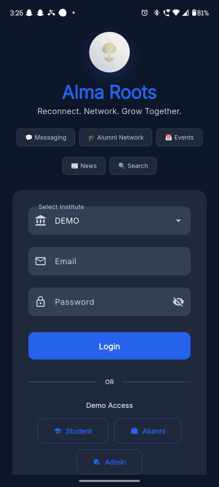
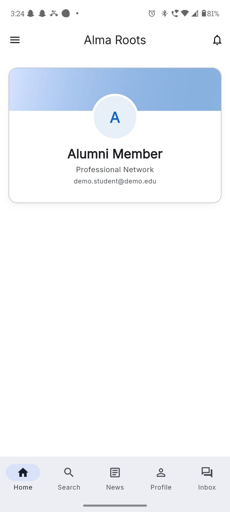
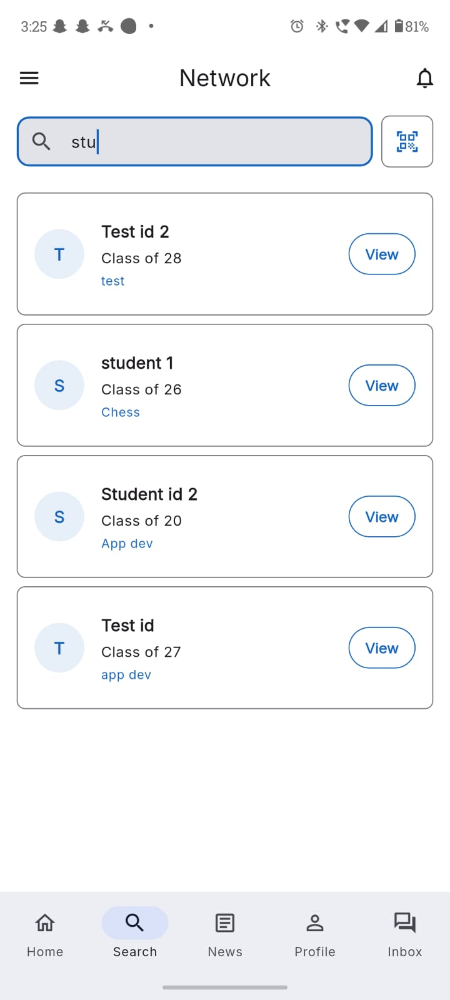
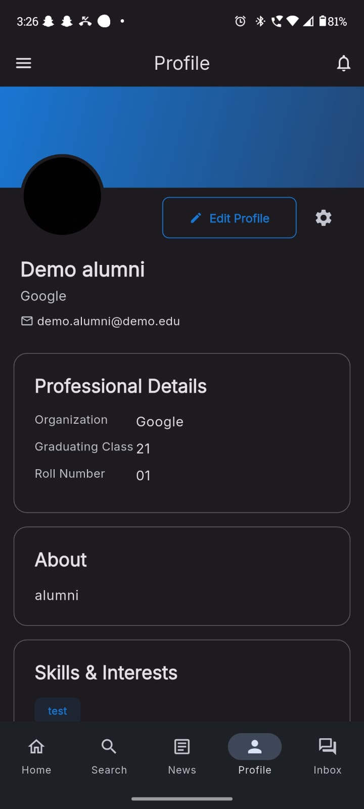
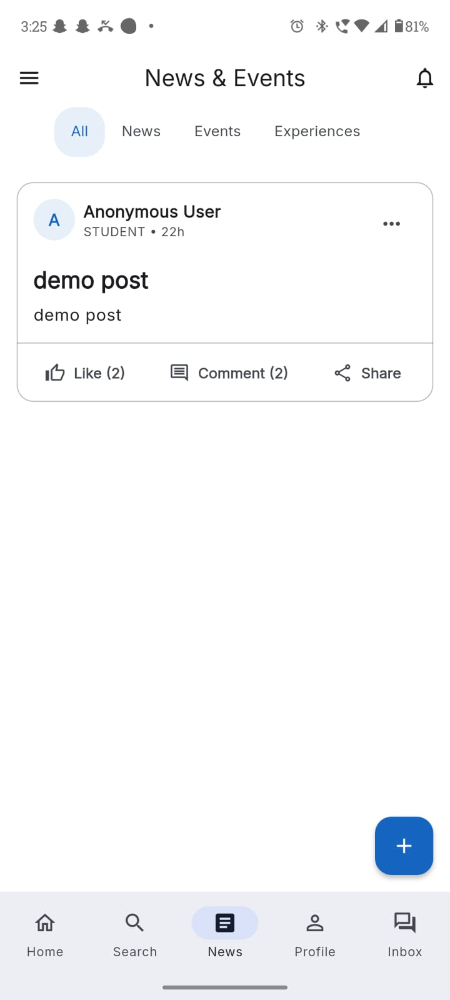
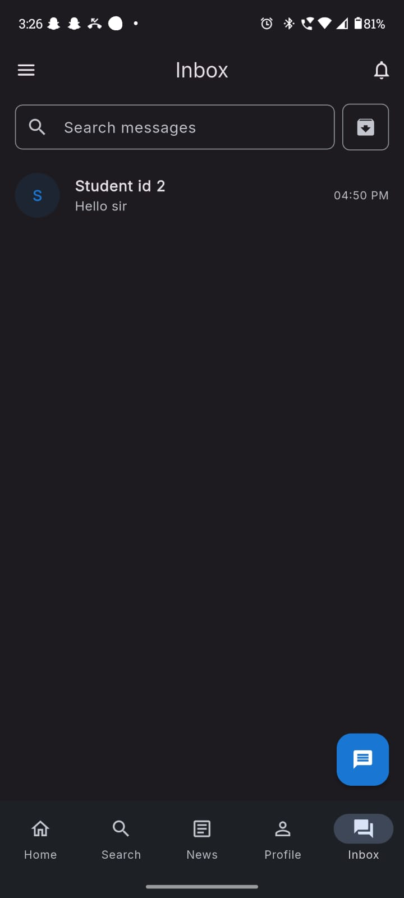
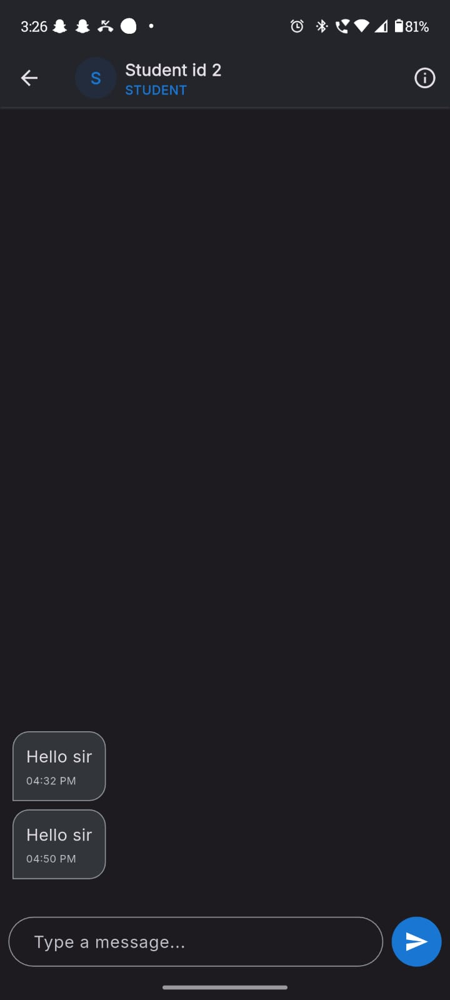
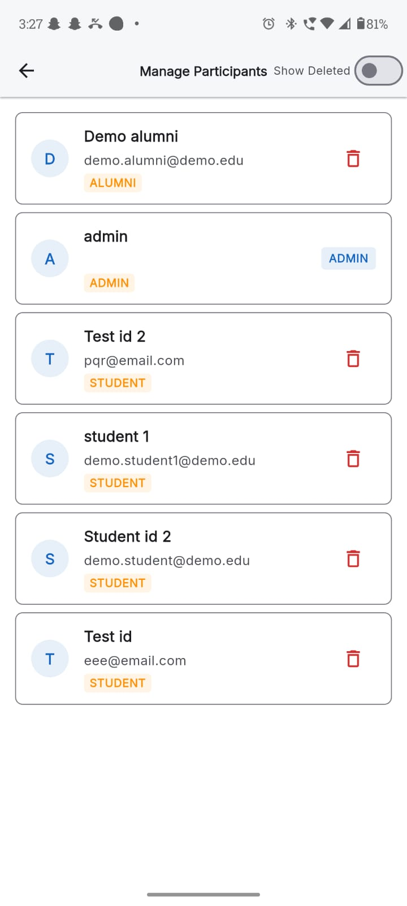
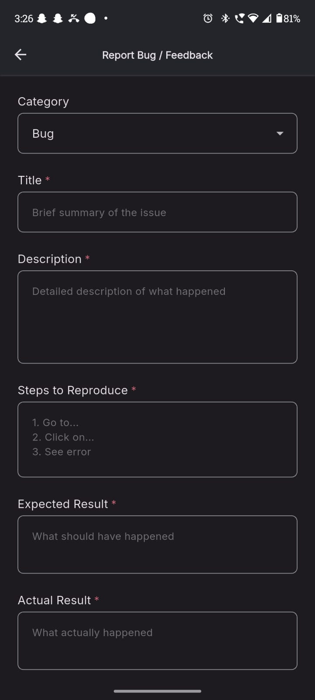

# Alma Roots 🎓🌱


**Alma Roots** is a comprehensive, production-ready Alumni Networking Platform built with Flutter and Firebase. It bridges the gap between students, alumni, and university administration through real-time communication, event discovery, and role-based access control.

---

## ✨ Key Features

- **Role-Based Access Control (RBAC):** Distinct workflows and UI experiences for Students, Alumni, and Admins.
- **Real-Time Messaging:** Live one-on-one chat using Cloud Firestore with secure read/write rules.
- **Interactive News & Events Feed:** Live streaming feed with real-time likes, comments, and RSVP tracking.
- **Smart User Lifecycle Management:** 
  - Advanced admin controls including account suspension (soft delete).
  - User-driven reactivation request system.
  - Admin-processed permanent deletion queue with automated Firebase Auth/Firestore data purging.
- **Secure Backend Compute:** Firebase Cloud Functions handle sensitive operations (like account creation and role promotion) to prevent privilege escalation.
- **QR Code Integration:** Quick connection and profile sharing via in-app QR scanning.

## 🚀 Demo & Download

### Demo Video
[Watch Full Demo Video](https://drive.google.com/file/d/1aXZtu89dug0q27ReIrrEwybESstT6WDw/view?usp=sharing)

### APK Download
[Download Latest APK](https://drive.google.com/file/d/1qszeJ2F2S9N4nD0L86fqanrlJ8xKdhgd/view?usp=sharing)

---

## 📸 Screenshots Gallery

### Authentication
**Login Screen**  


### Dashboard
**Home Screen**  


### Networking
**Search Users** | **Alumni Profile**
---|---
 | 

### Community
**News & Events Feed**  


### Messaging
**Inbox** | **Chat Screen**
---|---
 | 

### Administration
**User Management / Admin Dashboard**  


### Feedback System
**Feedback Reports**  


---

## 📊 Highlights

- Multi-role architecture (Student, Alumni, Admin)
- Firebase Authentication
- Cloud Firestore
- Cloud Functions
- Real-time Messaging
- Secure Firestore Rules
- News & Events Feed
- Search & Discovery
- Soft Delete Workflow
- Reactivation Requests
- Permanent Deletion Queue
- Audit Logging
- QR Code Integration

---

## 📂 Project Structure

```text
lib/
├── model/           # Data models (serialization/deserialization)
├── screen/          # Feature-based UI screens
├── service/         # Singleton services handling Firebase and business logic
├── theme/           # Global styles, colors, and themes
├── utils/           # Helper functions
├── widget/          # Reusable UI components
└── main.dart        # Entry point

functions/
├── index.js         # Cloud Functions source code
└── package.json     # Node.js dependencies
```

---

## 🏗️ Architecture & Tech Stack

- **Frontend:** Flutter (Dart) using modern declarative UI patterns and a highly modular directory structure.
- **Backend/BaaS:** Firebase Authentication, Cloud Firestore (NoSQL), Firebase Storage.
- **Serverless Compute:** Firebase Cloud Functions (Node.js) for administrative tasks.
- **State Management & Services:** Singleton service pattern (`AdminService`, `NewsEventService`, `ChatService`) with reactive `StreamBuilder` UI bindings.

## 🗄️ Database Design (Firestore)

The database utilizes a highly scalable, hierarchical structure scoped by `instituteId` to ensure data isolation:
- `institutes/{instId}/participants`: Core user data and roles.
- `institutes/{instId}/posts`: Feed content (with nested subcollections for `comments` and `likes`).
- `institutes/{instId}/chats`: Messaging system with participant arrays for strict query filtering.
- `institutes/{instId}/deletion_queue` & `reactivation_requests`: State-machine collections for secure user lifecycle management.

## 🛡️ Security Features

- **Firestore Rules:** Strict RBAC enforced at the database layer. Users can only read chats they are participants in, and they can only edit their own posts.
- **Tombstoning:** Soft-deleted users are tombstoned securely, preventing immediate permanent data loss while instantly revoking app access.
- **Audit Logging:** Every manual admin action (deletions, role changes) is permanently logged to an `admin_actions` collection to maintain accountability.

---

## 🚀 Installation & Setup

1. **Clone the repository:**
   ```bash
   git clone https://github.com/Aadeesh-01/CS261-Project.git
   cd CS261-Project
   ```

2. **Install Dependencies:**
   ```bash
   flutter pub get
   ```

3. **Firebase Setup:**
   - Create a Firebase Project.
   - Run `flutterfire configure` to generate the `firebase_options.dart` file.
   - Deploy the required Cloud Functions and Firestore Rules:
     ```bash
     firebase deploy --only functions
     firebase deploy --only firestore:rules
     ```

4. **Run the App:**
   ```bash
   flutter run
   ```

---

## 🔑 Demo Accounts

### Admin
- **Email:** adminabc@email.com
- **Password:** Demo@123

### Student
- **Email:** demo.student@demo.edu
- **Password:** Demo@123

### Alumni
- **Email:** demo.alumni@demo.edu
- **Password:** Demo@123

---

## 🔮 Future Enhancements

- Push Notifications
- Alumni Mentorship Program
- Internship Referral System
- AI-powered Networking Suggestions
- Analytics Dashboard
- Enhanced Event Registration

---

## 👥 Development Team

| Name |
|------|
| Aadeesh Surana |
| Lokesh Prajapat |
| Nitin Raj Singh |
| Mehul Mehra |
| Archan Dave |
| Ayush Bagdai |