# Alma Roots 🎓🌱


**Alma Roots** is an alumni networking app built with Flutter and Firebase. Students, alumni and institute admins can find each other, message in real time, share news, events and experiences, and manage their community, each institute in its own private space.

---

## ✨ Key Features

**For students and alumni**
- **Home dashboard:** a greeting, profile-completion progress, quick actions, unread messages, upcoming events and the latest posts.
- **Network search:** find people by name, skill, company, department or year, or scan a profile QR code.
- **Profiles:** bio, skills, company, department, plus *Mentor*, *Hiring* and *Open to networking* badges, and a personal QR code.
- **Real-time messaging:** 1-to-1 chats with read ticks, reactions, editing, "delete for me", pinning, archiving and quick networking intros.
- **News, events and experiences feed:** likes, comments, event RSVPs with capacity limits and a waitlist that promotes people automatically when a spot opens.
- **Push notifications:** new messages, news and events, waitlist spots and account updates, each switchable in Settings.
- **Light, dark or system theme.**

**For admins**
- **Admin console** with live member stats and badges for pending work, plus full access to the feed (news, announcements, pinning) and inbox.
- **User management:** create accounts, search and filter members, deactivate, restore.
- **Account lifecycle:** reactivation requests and permanent deletion with a 24-hour grace period, processed automatically.
- **Feedback inbox** for bug reports and feature requests.
- **Audit log** of every admin action.

**Security**
- Firestore and Storage security rules enforce roles, post visibility, chat privacy and counter integrity in the database, not just in the app.
- Privileged operations (creating accounts, granting admin, permanent deletion) run in Cloud Functions and check that the caller is an admin of that institute.
- Covered by automated tests (see [Testing](#-testing)).

## 📲 Download

[Download the APK](https://drive.google.com/file/d/1qszeJ2F2S9N4nD0L86fqanrlJ8xKdhgd/view?usp=sharing)

---

## 📸 Screenshots

| Login | Home | Network |
|:---:|:---:|:---:|
| 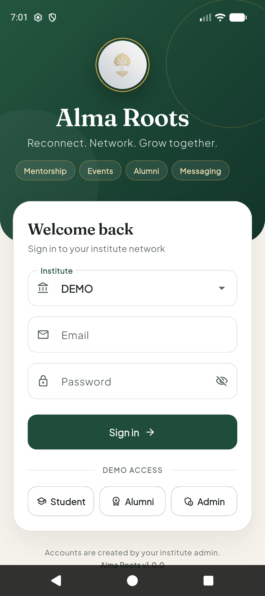 | 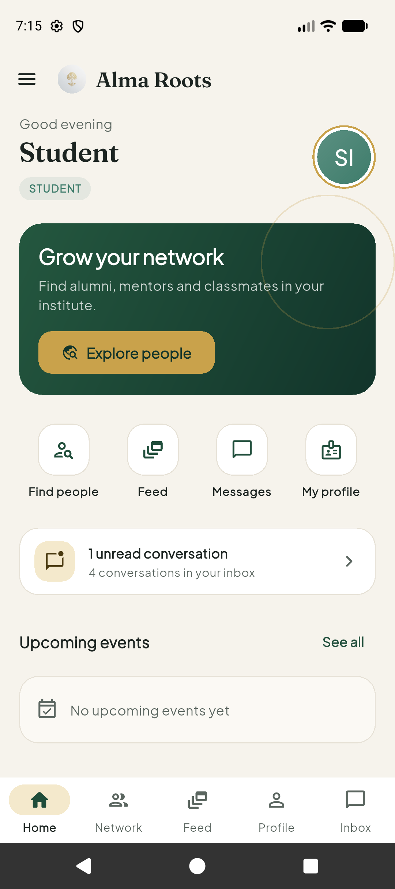 | 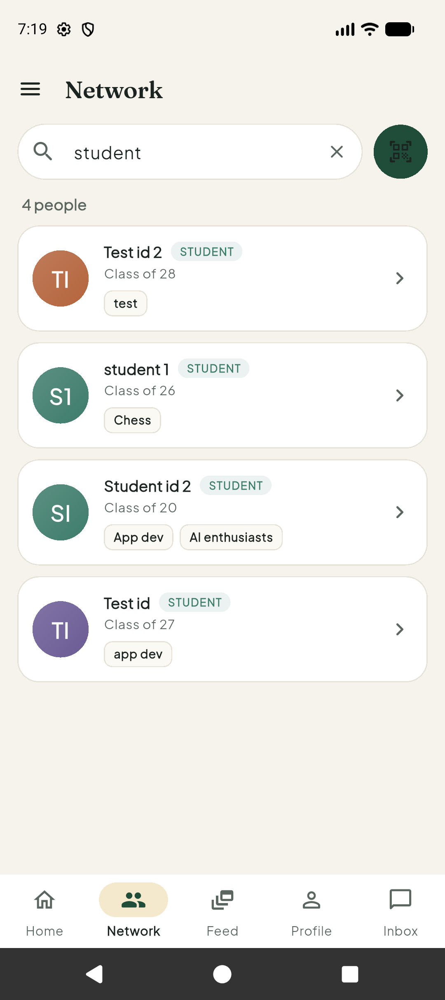 |

| Profile | News & Events | Post & comments |
|:---:|:---:|:---:|
| 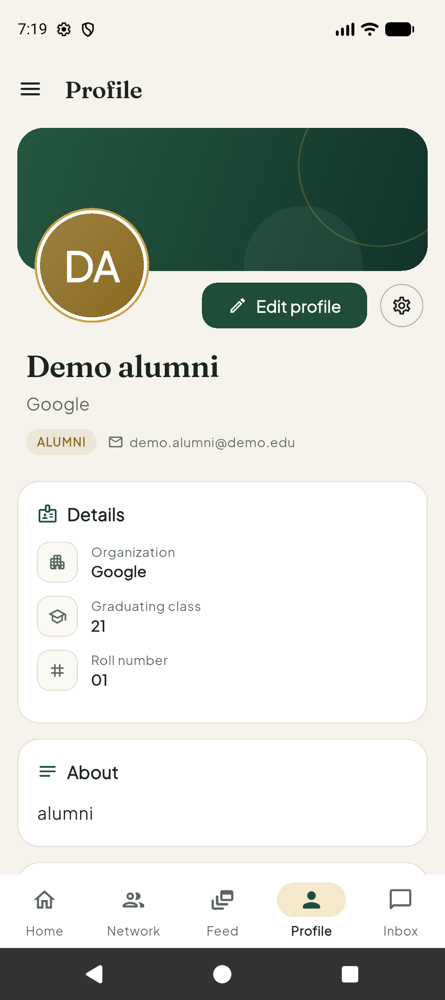 | 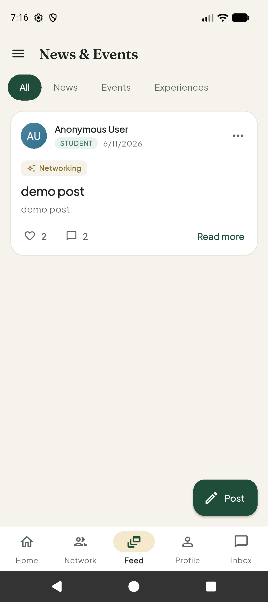 | 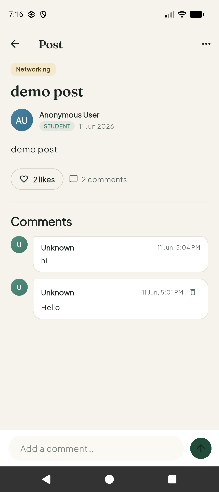 |

| Inbox | Chat | Settings |
|:---:|:---:|:---:|
| 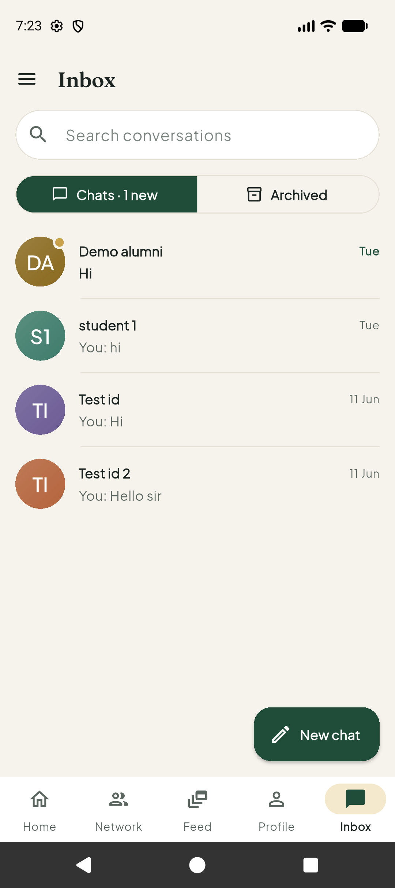 | 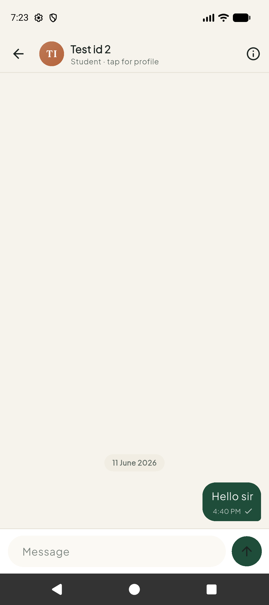 | 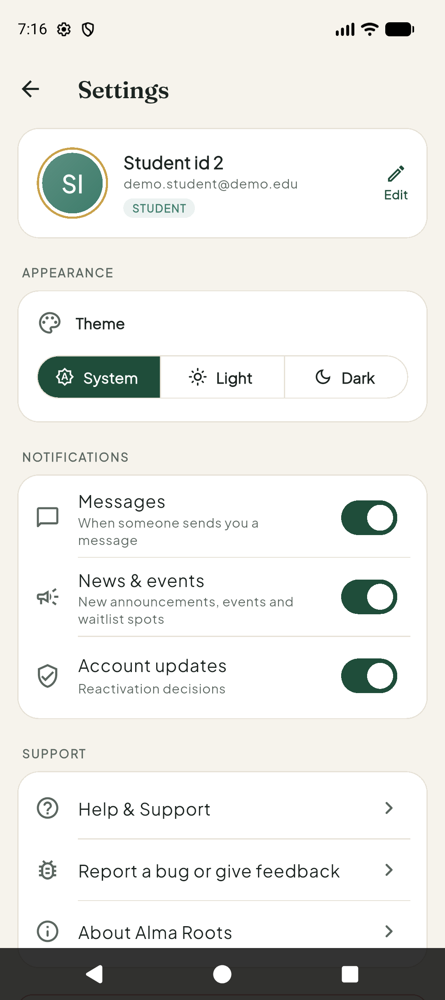 |

| Admin console | Manage users | Feedback reports |
|:---:|:---:|:---:|
| 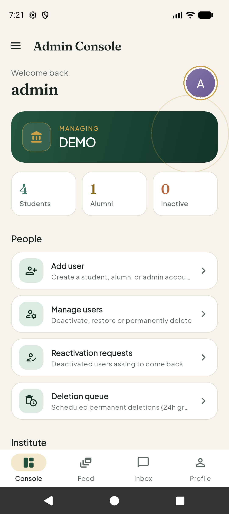 | 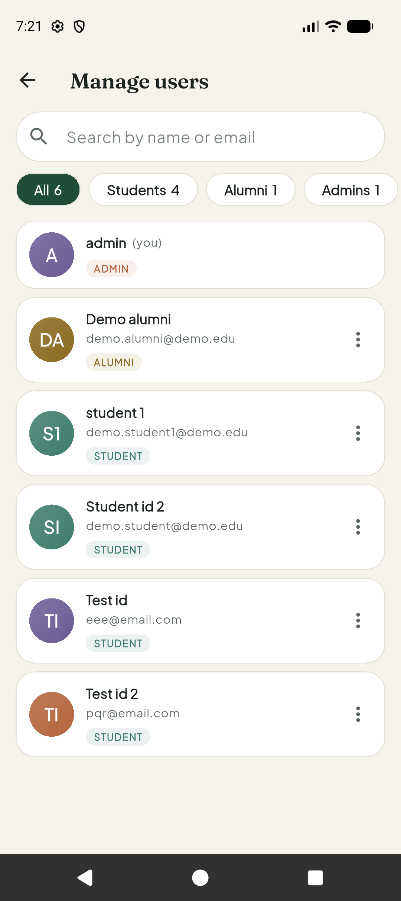 | 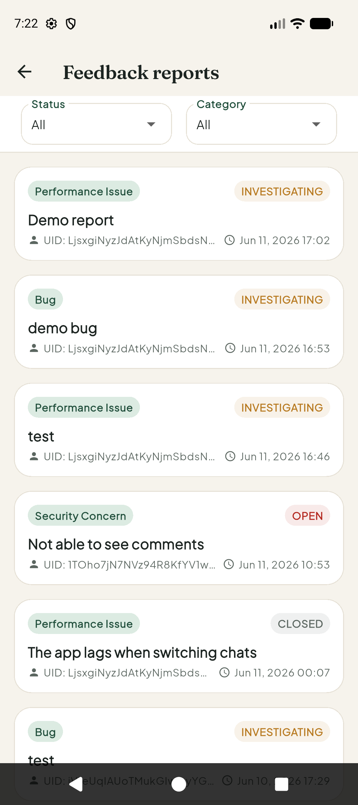 |

---

## 🏗️ Architecture & Tech Stack

- **App:** Flutter (Dart), Material 3 with a custom forest-green and gold theme (Fraunces and Plus Jakarta Sans fonts).
- **Backend:** Firebase Authentication, Cloud Firestore, Cloud Storage, Firebase Cloud Messaging.
- **Server logic:** Cloud Functions (Node.js, 2nd gen, `asia-south1`):

| Function | What it does |
|---|---|
| `createParticipantAccount` | Admin creates a student, alumni or admin account |
| `addAdminRole` | Admin promotes an existing user in their institute |
| `processDeletionQueueNow` | Admin runs pending permanent deletions on demand |
| `processPermanentDeletionQueue` | Runs every 5 minutes and deletes accounts whose 24h grace period has ended |
| `normalizeDeletionSchedule` | Sets the 24h deadline from server time |
| `notifyNewMessage`, `notifyNewPost`, `notifyReactivationDecision` | Push notifications |
| `promoteWaitlist` | Gives a freed event spot to the next person on the waitlist |

## 🗄️ Database Design (Firestore)

Everything is scoped by institute so each institute's data stays separate:

- `institutes/{instId}/participants`: users, roles and profiles
- `institutes/{instId}/posts`: feed posts, with `comments`, `likes` and `attendees` subcollections
- `institutes/{instId}/chats/{chatId}/messages`: 1-to-1 conversations
- `institutes/{instId}/deletion_queue`, `reactivation_requests`: account lifecycle
- `institutes/{instId}/feedback`: bug reports and feature requests
- `institutes/{instId}/admin_actions`: append-only audit log

## 📂 Project Structure

```text
lib/
├── model/           # Data models
├── screen/          # Screens, grouped by feature (admin, auth, events_and_news, message, profile, search, settings, student)
├── service/         # Firebase access and business logic
├── theme/           # Colours, spacing and theme
├── utils/           # Helpers
├── widget/          # Reusable UI components
└── main.dart        # Entry point

functions/index.js   # Cloud Functions
firestore.rules      # Firestore security rules
storage.rules        # Cloud Storage security rules
firestore.indexes.json
```

---

## 🚀 Installation & Setup

1. **Clone the repository**
   ```bash
   git clone https://github.com/Aadeesh-01/Alma_Roots.git
   cd Alma_Roots
   ```

2. **Install dependencies**
   ```bash
   flutter pub get
   npm install                 # tools for the security-rule tests
   cd functions && npm install && cd ..
   ```

3. **Connect Firebase**
   - Create a Firebase project on the Blaze plan (Cloud Functions require it).
   - Run `flutterfire configure` to generate `lib/firebase_options.dart`.
   - Deploy the backend:
     ```bash
     firebase deploy --only firestore:rules,firestore:indexes,storage,functions
     ```

4. **Run the app**
   ```bash
   flutter run
   ```

## 🧪 Testing

```bash
flutter analyze             # static analysis
flutter test                # unit and widget tests
npm run test:rules          # Firestore security rules (Firestore emulator)
npm run test:storage        # Storage security rules (Storage emulator)
```

The rules tests need the Firebase CLI and Java 21 or newer.

---

## 🔑 Demo Accounts

| Role | Email | Password |
|---|---|---|
| Admin | adminabc@email.com | 123456 |
| Student | demo.student@demo.edu | Demo@123 |
| Alumni | demo.alumni@demo.edu | Demo@123 |

The login screen also has one-tap **Demo Access** buttons.

---

## 🔮 Future Enhancements

- Group chats and attachments
- Alumni mentorship matching
- Internship and referral board
- AI-powered networking suggestions
- Analytics dashboard for admins
- iOS push notifications

---

## 👥 Development Team

| Name |
|------|
| Aadeesh Surana |
