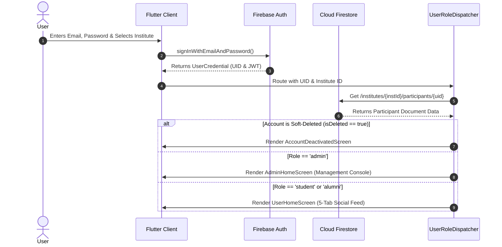

# Backend Architecture Analysis — Alumni Connect (CS261-Project)

> **Application Name:** Alumni Connect (`CS261-Project`)  
> **Ecosystem:** Flutter (Mobile Client), Google Cloud Platform, Firebase Serverless Architecture  
> **Target Audience:** Engineering Students, System Architects, Technical Interviewers  
> **Document Purpose:** A complete, beginner-friendly, and technically thorough breakdown of the entire backend infrastructure, security rules, serverless functions, database schema, data flows, and security findings based on the active codebase.

---

# Table of Contents
1. [High-Level Architecture Diagram](#1-high-level-architecture-diagram)
2. [End-to-End Component Breakdown](#2-end-to-end-component-breakdown)
   - [2.1 Firebase Authentication](#21-firebase-authentication)
   - [2.2 Cloud Firestore (Database)](#22-cloud-firestore-database)
   - [2.3 Firestore Security Rules](#23-firestore-security-rules)
   - [2.4 Cloud Functions (Serverless Backend)](#24-cloud-functions-serverless-backend)
   - [2.5 Firebase Cloud Messaging (FCM & Push Notifications)](#25-firebase-cloud-messaging-fcm--push-notifications)
   - [2.6 Firebase Storage](#26-firebase-storage)
   - [2.7 Firebase App Check](#27-firebase-app-check)
   - [2.8 Google Cloud & Server Infrastructure](#28-google-cloud--server-infrastructure)
   - [2.9 Configuration & Deployment Files](#29-configuration--deployment-files)
3. [Complete Database & Schema Structure](#3-complete-database--schema-structure)
4. [Authentication & Role-Based Navigation Flow](#4-authentication--role-based-navigation-flow)
5. [End-to-End Data Flow Scenarios](#5-end-to-end-data-flow-scenarios)
6. [Security Vulnerabilities & Configuration Flaws Found](#6-security-vulnerabilities--configuration-flaws-found)
7. [Production Deployment Guide & Recommendations](#7-production-deployment-guide--recommendations)

---

# 1. High-Level Architecture Diagram

```mermaid
graph TD
    Client[Flutter Mobile App (Android / iOS)]
    Auth[Firebase Authentication (JWT & Claims)]
    DB[(Cloud Firestore - asia-south1)]
    Storage[Firebase Storage (Bucket: project-cs261)]
    CF[Cloud Functions v2 (Node.js 20 - asia-south1)]
    FCM[Firebase Cloud Messaging (NotificationService)]
    Rules{Firestore Security Rules}

    Client -->|1. Sign In / Auth Token| Auth
    Client -->|2. Upload Avatars| Storage
    Client -->|3. Read / Write Data| Rules
    Rules -->|4. Allow / Deny| DB
    Client -->|5. Call Privileged APIs| CF
    CF -->|6. Admin SDK (Bypass Rules)| DB
    CF -->|7. Admin SDK (Create/Delete Users)| Auth
    CF -->|8. Cron Worker (Every 5 Mins)| DB
    FCM -.->|Push Notifications (Unwired)| Client
```

### Simplified Architecture Flow
```text
Flutter Mobile App
       │
       ├──> Firebase Auth (Authentication & Custom Claims)
       │
       ├──> Cloud Firestore (Hierarchical Multi-Tenant NoSQL Data)
       │         ▲
       │         └── Secured by firestore.rules (Security Gateway)
       │
       ├──> Cloud Functions (Privileged Admin Tasks & Scheduled Purges)
       │
       ├──> Firebase Storage (User Profile Images)
       │
       └──> FCM (Push Notifications Engine)
```

---

# 2. End-to-End Component Breakdown

---

## 2.1 Firebase Authentication

* **What It Does:**  
  Handles user sign-in, manages cryptographically signed JSON Web Tokens (JWTs), and assigns unique identifiers (`uid`) to users.
* **Controlling Files:**  
  - [`lib/screen/auth.dart`](file:///c:/Flutter_projects/new_cs/CS261-Project/lib/screen/auth.dart) (Active login interface)
  - [`lib/service/auth_service.dart`](file:///c:/Flutter_projects/new_cs/CS261-Project/lib/service/auth_service.dart) (Legacy/alternate auth service)
  - [`lib/service/user_role_dispatcher.dart`](file:///c:/Flutter_projects/new_cs/CS261-Project/lib/service/user_role_dispatcher.dart) (Post-login route selector)
  - [`functions/index.js`](file:///c:/Flutter_projects/new_cs/CS261-Project/functions/index.js) (Administrative account provisioning)
* **How It Connects to Flutter:**  
  Initialized in [`lib/main.dart`](file:///c:/Flutter_projects/new_cs/CS261-Project/lib/main.dart#L19-L22) using `Firebase.initializeApp(options: DefaultFirebaseOptions.currentPlatform)`. Flutter listens continuously to `FirebaseAuth.instance.authStateChanges()` to maintain persistent sessions across app restarts.
* **Key Mechanisms:**  
  - **No Public Self-Registration:** General users cannot sign themselves up from the mobile login screen. Only Institute Administrators can create accounts using the backend Cloud Function `createParticipantAccount`.
  - **Custom Claims:** When an administrator provisions another admin, the backend executes `admin.auth().setCustomUserClaims(uid, { role: "admin" })`. This embeds `{ role: "admin" }` directly into the user's signed JWT token.
  - **Multi-Tenant Scoping:** During login, users select their institute. The app validates that the user's Auth UID physically exists inside `/institutes/{selectedInstituteId}/participants/{uid}` before granting access.

---

## 2.2 Cloud Firestore (Database)

* **What It Does:**  
  Serves as the primary distributed, real-time NoSQL document database.
* **Architectural Pattern:**  
  **Multi-Tenant Hierarchical Subcollections**. Data is physically partitioned under specific university/institute identifiers: `/institutes/{instituteId}/...`
* **Controlling Files:**  
  - [`lib/service/news_event_service.dart`](file:///c:/Flutter_projects/new_cs/CS261-Project/lib/service/news_event_service.dart) (Posts, RSVPs, comments, likes)
  - [`lib/service/chat_service.dart`](file:///c:/Flutter_projects/new_cs/CS261-Project/lib/service/chat_service.dart) (1:1 direct messaging and inboxes)
  - [`lib/service/admin_service.dart`](file:///c:/Flutter_projects/new_cs/CS261-Project/lib/service/admin_service.dart) (Soft deletes, restoration, deletion queues)
  - [`lib/service/profile_service.dart`](file:///c:/Flutter_projects/new_cs/CS261-Project/lib/service/profile_service.dart) (Profile CRUD)
  - [`lib/service/search_service.dart`](file:///c:/Flutter_projects/new_cs/CS261-Project/lib/service/search_service.dart) (Prefix token search)
  - [`firestore.indexes.json`](file:///c:/Flutter_projects/new_cs/CS261-Project/firestore.indexes.json) (Composite B-Tree query indexes)
* **How Flutter Reads and Writes Data:**  
  - **Real-Time Streaming (`Stream<QuerySnapshot>`):** Flutter uses `.snapshots()` for live chat feeds and post streams. Any database change is pushed instantly to the mobile screen via bidirectional gRPC.
  - **Atomic Multi-Document Transactions (`runTransaction`):** Used in `toggleRsvp` and `toggleLike` to prevent race conditions and overbooking. Reads and writes execute together; if concurrent writes collide, Firestore retries automatically.
  - **Batched Writes (`WriteBatch`):** Used in `ChatService.sendDirectMessage` and `AdminService.softDeleteUser` to atomically update multiple documents (e.g., adding a message and updating the parent chat's `lastMessage` preview simultaneously).
  - **Atomic Counter Increments:** Uses `FieldValue.increment(1)` or `-1` to update likes and attendee counts without document read locks.

---

## 2.3 Firestore Security Rules

* **What It Does:**  
  Acts as an unbypassable security firewall evaluated directly at the database gateway before queries are executed.
* **Controlling File:**  
  [`firestore.rules`](file:///c:/Flutter_projects/new_cs/CS261-Project/firestore.rules)
* **Core Rule Implementations:**
  1. **Tenant Sandboxing:** `isInstituteMember(instId)` verifies that the caller's Auth UID physically exists in that specific institute before any data is returned.
  2. **Anti-Privilege Escalation:** In `/participants/{userId}`, users can update their profile, but the rule enforces:
     ```javascript
     request.resource.data.get('role', resource.data.get('role', 'student')) == resource.data.get('role', 'student')
     ```
     This prevents a student from changing their role to `admin` or changing their status to `active` if they were suspended.
  3. **Role-Gated Post Creation:**
     - Students & Alumni: Permitted to create posts of type `experience` or `event`.
     - Admins: Permitted to create all types, including official `news` and `announcements`.
  4. **Strict Zero-Trust Chat Privacy:**
     Admins **cannot** read direct messages between students. Only users whose UIDs are in the `participants` array have read access.
  5. **Immutable Audit Trail:**
     The `admin_actions` collection allows creation by admins but explicitly blocks all edits and deletions (`allow update, delete: if false`).

---

## 2.4 Cloud Functions (Serverless Backend)

* **What It Does:**  
  Executes privileged backend code, manages administrative credentials, coordinates cross-system distributed transactions, and runs automated scheduled maintenance.
* **Controlling File:**  
  [`functions/index.js`](file:///c:/Flutter_projects/new_cs/CS261-Project/functions/index.js) (Node.js 20 runtime)
* **Region:**  
  `asia-south1` (Mumbai, India)

### Functions Registry

| Function Name | Trigger | Permissions | What It Does |
| :--- | :--- | :--- | :--- |
| `createParticipantAccount` | HTTPS Callable (`onCall`) | Admin (`auth.token.role === 'admin'`) | 1. Normalizes email.<br>2. Checks for duplicates in Auth and Firestore.<br>3. Creates Firebase Auth user.<br>4. Generates sequential `customId` (`s1`, `a1`, `ad1`).<br>5. Creates participant document and audit log.<br>6. Assigns admin claim if role is admin.<br>7. **Compensating Rollback:** Deletes Auth user if Firestore write fails. |
| `addAdminRole` | HTTPS Callable (`onCall`) | System / Admin | Promotes user by assigning `{ role: "admin" }` custom claim and updating Firestore document. |
| `processDeletionQueueNow` | HTTPS Callable (`onCall`) | Admin (Checked in Firestore) | Instantly triggers batch deletion for a target user or the eligible queue. Deletes Auth account, archives document, writes tombstone (`permanently_deleted`), and updates queue. |
| `processPermanentDeletionQueue` | Scheduled Cron (`onSchedule("every 5 minutes")`) | Google Cloud Scheduler | Runs every 5 minutes. Queries all tenant deletion queues via `collectionGroup("deletion_queue")` where `scheduledFor <= now`, and purges accounts whose 24-hour grace window expired. |

---

## 2.5 Firebase Cloud Messaging (FCM & Push Notifications)

* **What It Does:**  
  Intended to deliver background and terminated push notifications to devices when messages or campus events occur.
* **Controlling File:**  
  [`lib/service/notification_service.dart`](file:///c:/Flutter_projects/new_cs/CS261-Project/lib/service/notification_service.dart)
* **Current Implementation State:**  
  - Contains background callback `@pragma('vm:entry-point') Future<void> _firebaseMessagingBackgroundHandler`.
  - Configures `FlutterLocalNotificationsPlugin` for foreground notification display.
* **Architectural Gap:**  
  - `NotificationService().init()` is **never invoked in `main.dart`**.
  - Device tokens (`FirebaseMessaging.instance.getToken()`) are never captured or saved to the Firestore user profile.
  - The backend Cloud Functions currently have no triggers to send messages via `admin.messaging().send()`.

---

## 2.6 Firebase Storage

* **What It Does:**  
  Stores binary media assets (specifically user profile avatar photos).
* **Controlling Files:**  
  - [`lib/firebase_options.dart`](file:///c:/Flutter_projects/new_cs/CS261-Project/lib/firebase_options.dart#L57) (Bucket: `project-cs261.firebasestorage.app`)
  - [`lib/screen/profile/profile_edit_screen.dart`](file:///c:/Flutter_projects/new_cs/CS261-Project/lib/screen/profile/profile_edit_screen.dart#L89-L93)
* **How It Works:**  
  Users select a picture using `ImagePicker`. The app uploads the file to `profile_pictures/${user.uid}/avatar.jpg` and writes the resulting download URL back to the `profileImage` field in the user's Firestore document.
* **Architectural Gap:**  
  There is **no `storage.rules` file** in the repository. Access control is currently unmanaged in source control.

---

## 2.7 Firebase App Check

* **What It Does:**  
  Cryptographically validates that incoming traffic originates exclusively from your genuine, untampered mobile app (using Google Play Integrity on Android and DeviceCheck/App Attest on iOS), blocking unauthorized API clients, bots, and curl scripts.
* **Current Status:**  
  **Not implemented.** `firebase_app_check` is not in `pubspec.yaml`, leaving backend APIs open to direct HTTP calls if credentials are extracted from the client binary.

---

## 2.8 Google Cloud & Server Infrastructure

* **Cloud Provider:** Google Cloud Platform (GCP)
* **Project ID:** `project-cs261`
* **Project Number:** `38444085565`
* **Data Center Region:** `asia-south1` (Mumbai, India) for Cloud Functions and Firestore.
* **Communication Protocols:**
  - Client-to-DB: Persistent bidirectional **gRPC over HTTP/2** with TLS.
  - Client-to-Functions: HTTPS POST (JSON-RPC callable format).
  - Background Workers: Google Cloud Scheduler firing Cloud Functions v2 endpoints.

---

## 2.9 Configuration & Deployment Files

* [`firebase.json`](file:///c:/Flutter_projects/new_cs/CS261-Project/firebase.json): Links `firestore.rules`, `firestore.indexes.json`, and the `functions/` directory for Firebase CLI deployments.
* [`lib/firebase_options.dart`](file:///c:/Flutter_projects/new_cs/CS261-Project/lib/firebase_options.dart): Auto-generated configuration containing API keys and App IDs for Android and iOS.
* [`android/app/google-services.json`](file:///c:/Flutter_projects/new_cs/CS261-Project/android/app/google-services.json): Native Android Firebase SDK configuration.
* [`functions/package.json`](file:///c:/Flutter_projects/new_cs/CS261-Project/functions/package.json): Node.js 20 environment declaration with deployment scripts (`npm run deploy`).

---

# 3. Complete Database & Schema Structure

The Firestore database utilizes a **hierarchical multi-tenant schema**:

```
/institutes/{instId}
    │
    ├── /participants/{userId}           (Core User Profile & Credentials)
    │
    ├── /posts/{postId}                  (Campus Notices, Events & Experiences)
    │       ├── /comments/{commentId}    (Post Discussion Comments)
    │       ├── /likes/{userId}          (Like Junction Documents)
    │       └── /attendees/{userId}      (RSVP / Waitlist Records)
    │
    ├── /chats/{chatId}                  (1:1 Direct Chat Threads: uid1_uid2)
    │       └── /messages/{messageId}    (Real-time Chat Messages)
    │
    ├── /admin_actions/{actionId}        (Immutable Audit Trail Logs)
    │
    ├── /deletion_queue/{userId}         (24-Hour Permanent Deletion Staging Queue)
    │
    ├── /reactivation_requests/{userId}  (Account Reactivation Petitions)
    │
    ├── /feedback/{feedbackId}           (Student Bug Reports & Feedback)
    │
    └── /archived_users/{userId}         (Pre-purge User Snapshots)

/super_admins/{userId}                   (Global Platform Administrators)
```

### Key Entities & Fields

| Entity / Collection | Document ID Format | Important Attributes |
| :--- | :--- | :--- |
| `participants` | Auth `uid` | `name`, `email`, `role` (`student`/`alumni`/`admin`), `status` (`active`/`deleted`), `isDeleted`, `customId` (`s1`/`a1`/`ad1`), `rollNo`, `company`, `year`, `searchKeywords` |
| `posts` | Auto UUID | `type` (`news`/`event`/`experience`), `category`, `visibility` (`public`/`alumni_only`/`students_only`/`admins_only`), `title`, `authorUid`, `likeCount`, `commentCount`, `attendeeCount`, `maxAttendees`, `isPinned` |
| `chats` | Deterministic `uid1_uid2` (Alphabetical) | `participants` (Array of 2 UIDs), `lastMessage` (Map preview), `lastMessageTimestamp`, `readStatus` (Map), `pinnedBy`, `mutedBy` |
| `messages` | Auto UUID | `senderId`, `text`, `type` (`text`/`image`/`document`), `timestamp`, `reactions` (Map), `deletedBy` (Map per-user delete) |
| `deletion_queue` | Target User `uid` | `uid`, `email`, `status` (`pending`/`completed`/`cancelled`), `scheduledFor`, `requestedBy` |
| `admin_actions` | Auto UUID | `action`, `adminUid`, `targetUid`, `targetEmail`, `timestamp` |

---

# 4. Authentication & Role-Based Navigation Flow



---

# 5. End-to-End Data Flow Scenarios

### Scenario A: Admin Provisions a New User (With Rollback Protection)
1. Administrator opens `AdminAddParticipantScreen` and submits user details.
2. Flutter invokes the Cloud Function `createParticipantAccount`.
3. Cloud Function validates caller JWT: `auth.token.role === 'admin'`.
4. Cloud Function checks for duplicate email in Firebase Auth and Firestore.
5. Cloud Function calls `admin.auth().createUser()`.
6. Cloud Function computes sequential ID (`s10`, `a14`), tokenizes search keywords, and saves `/institutes/{instId}/participants/{uid}`.
7. **Saga Compensating Rollback:** If the Firestore write fails, the `catch` block calls `admin.auth().deleteUser(uid)` to delete the orphaned auth record.

### Scenario B: Student RSVPs to an Event (Concurrency Protection)
1. Student taps "RSVP" on a workshop with limited seats.
2. Flutter executes `NewsEventService.toggleRsvp` inside `_firestore.runTransaction`.
3. The transaction reads the post document to check `attendeeCount` vs `maxAttendees`.
4. If full, it redirects to the waitlist or throws an exception.
5. If open, it atomically writes the attendee document to `/posts/{id}/attendees/{uid}` and applies `FieldValue.increment(1)` to `attendeeCount`.
6. **Optimistic Concurrency Control:** If another student books the last seat simultaneously, Firestore automatically retries the transaction, reads the updated count, and rejects the second booking.

### Scenario C: 24-Hour Account Purge Workflow
1. Administrator schedules a user deletion in `AdminParticipantListScreen`.
2. `AdminService.schedulePermanentDeletion` commits a `WriteBatch`:
   - Flags `pendingPermanentDeletion: true` on the participant.
   - Inserts record into `/institutes/{instId}/deletion_queue/{uid}` with `scheduledFor = now + 24 hours`.
   - Logs audit trail record in `admin_actions`.
3. Every 5 minutes, `processPermanentDeletionQueue` runs in Cloud Functions.
4. It finds expired records, permanently deletes the Firebase Auth account, archives metadata to `archived_users/{uid}`, tombstones the participant document to `status: 'permanently_deleted'`, and completes the queue item.

---

# 6. Security Vulnerabilities & Configuration Flaws Found

During the codebase audit, **7 specific security and configuration flaws** were identified:

### 1. Cloud Function Region Mismatch in `AdminService`
* **File:** [`lib/service/admin_service.dart:339`](file:///c:/Flutter_projects/new_cs/CS261-Project/lib/service/admin_service.dart#L339)
* **The Problem:** The app calls:
  ```dart
  final callable = FirebaseFunctions.instance.httpsCallable('processDeletionQueueNow');
  ```
  `FirebaseFunctions.instance` defaults to `us-central1`. However, in [`functions/index.js:275`](file:///c:/Flutter_projects/new_cs/CS261-Project/functions/index.js#L275), the backend function is deployed to `asia-south1`.
* **Impact:** Tapping "Process Deletion Queue" in production will throw a `NOT_FOUND` error.
* **Correction Required:**
  ```dart
  final callable = FirebaseFunctions.instanceFor(region: 'asia-south1').httpsCallable('processDeletionQueueNow');
  ```

---

### 2. Missing Firebase Storage Security Rules
* **The Problem:** No `storage.rules` file exists in the repository, and `firebase.json` does not configure Storage rules deployment.
* **Impact:** Storage access is governed entirely by console defaults. If default locked, user avatar uploads fail; if default open, any authenticated user can overwrite arbitrary storage files.
* **Correction Required:** Create `storage.rules` and register it in `firebase.json`:
  ```javascript
  rules_version = '2';
  service firebase.storage {
    match /b/{bucket}/o {
      match /profile_pictures/{userId}/{allPaths=**} {
        allow read: if request.auth != null;
        allow write: if request.auth != null && request.auth.uid == userId;
      }
    }
  }
  ```

---

### 3. Hard-Coded Admin Mapping in `auth_service.dart`
* **File:** [`lib/service/auth_service.dart:68-72`](file:///c:/Flutter_projects/new_cs/CS261-Project/lib/service/auth_service.dart#L68-L72)
* **The Problem:**
  ```dart
  final Map<String, String> adminInstituteMap = {
    "adminabc@email.com": "INSTITUTE_ID_1",
    "adminxyz@email.com": "INSTITUTE_ID_2",
  };
  ```
* **Impact:** Hard-coding credentials and institute IDs in client-side source code is a security anti-pattern. While `main.dart` currently routes to `lib/screen/auth.dart`, this dead code should be purged to prevent accidental reuse.

---

### 4. FCM Service Is Unwired
* **Files:** [`lib/main.dart`](file:///c:/Flutter_projects/new_cs/CS261-Project/lib/main.dart) and [`lib/service/notification_service.dart`](file:///c:/Flutter_projects/new_cs/CS261-Project/lib/service/notification_service.dart)
* **The Problem:** `NotificationService().init()` is never called in `main.dart`. Device tokens are never stored in Firestore, and Cloud Functions has no trigger to send notifications.
* **Impact:** Push notifications are completely non-functional.

---

### 5. Client Device Clock Dependency for Deletion Grace Periods
* **File:** [`lib/service/admin_service.dart:238-240`](file:///c:/Flutter_projects/new_cs/CS261-Project/lib/service/admin_service.dart#L238-L240)
* **The Problem:**
  ```dart
  final scheduledDate = DateTime.now().add(const Duration(hours: 24));
  ```
* **Impact:** If an administrator's device clock is fast or manually set forward by 24 hours, the scheduled timestamp will be set in the past, allowing the background worker to immediately purge the user without the 24-hour grace window.
* **Correction Required:** Compute `scheduledFor` server-side inside a Cloud Function using `admin.firestore.Timestamp.now()`.

---

### 6. Firebase App Check Not Configured
* **The Problem:** `firebase_app_check` is not installed.
* **Impact:** Backend APIs can be reached by unauthorized HTTP scripts outside the official mobile application.

---

### 7. Unused Algolia Dependency in Backend
* **File:** [`functions/package.json:16`](file:///c:/Flutter_projects/new_cs/CS261-Project/functions/package.json#L16)
* **The Problem:** `"algoliasearch": "^4.20.0"` is listed as a dependency but never imported or used in `functions/index.js`.
* **Impact:** Unnecessarily increases Cloud Functions deployment bundle size and cold-start times.

---

# 7. Production Deployment Guide & Recommendations

### Step-by-Step Deployment Commands

1. **Deploy Firestore Security Rules & Indexes:**
   ```bash
   firebase deploy --only firestore:rules,firestore:indexes
   ```
2. **Deploy Cloud Functions to Mumbai (`asia-south1`):**
   ```bash
   cd functions
   npm install
   firebase deploy --only functions
   ```
3. **Deploy Storage Rules (After creating `storage.rules`):**
   ```bash
   firebase deploy --only storage
   ```

### Recommended Best-Practice Checklist
- [ ] Fix `FirebaseFunctions.instanceFor(region: 'asia-south1')` in `lib/service/admin_service.dart`.
- [ ] Create and deploy `storage.rules`.
- [ ] Delete hard-coded admin maps in `lib/service/auth_service.dart`.
- [ ] Connect `NotificationService().init()` in `lib/main.dart` and save FCM tokens to `/participants/{uid}`.
- [ ] Remove `"algoliasearch"` from `functions/package.json`.
- [ ] Integrate `firebase_app_check` with Google Play Integrity and iOS DeviceCheck.
