# Database Management Systems (DBMS) Concepts — Microsoft Interview Guide
> **Repository Under Analysis:** `Alma_Roots / CS261-Project` (Flutter, Firebase Cloud Firestore, Cloud Functions)  
> **Target Audience:** Microsoft Technical Interview Candidate (SDE I / SDE II / New Grad)  
> **Core Objective:** Provide a 100% personalized, code-backed DBMS guide explaining foundational and advanced database concepts **exclusively through the actual architecture, schema, transactions, and queries of this repository**.

---

# Table of Contents
1. [Evidence vs Inference Legend](#1-evidence-vs-inference-legend)
2. [Database Used in My Project](#2-database-used-in-my-project)
3. [Database Architecture & Multi-Tenancy](#3-database-architecture--multi-tenancy)
4. [Database Schema & Entity Dictionary](#4-database-schema--entity-dictionary)
5. [Entity-Relationship (ER) Diagram](#5-entity-relationship-er-diagram)
6. [Primary Keys & Identification Strategies](#6-primary-keys--identification-strategies)
7. [Foreign Keys & Referential Integrity](#7-foreign-keys--referential-integrity)
8. [Database Relationships (1:1, 1:N, M:N)](#8-database-relationships-11-1n-mn)
9. [Normalization in My Project (1NF, 2NF, 3NF vs NoSQL Denormalization)](#9-normalization-in-my-project-1nf-2nf-3nf-vs-nosql-denormalization)
10. [Database Queries Used in My Project (NoSQL vs Relational SQL Equivalents)](#10-database-queries-used-in-my-project-nosql-vs-relational-sql-equivalents)
11. [Joins & Relationship Resolution](#11-joins--relationship-resolution)
12. [Constraints & Integrity Enforcement](#12-constraints--integrity-enforcement)
13. [Indexing Deep-Dive](#13-indexing-deep-dive)
14. [Transactions & Atomic Operations](#14-transactions--atomic-operations)
15. [ACID Properties in My Project](#15-acid-properties-in-my-project)
16. [Concurrency, Isolation & Race Conditions](#16-concurrency-isolation--race-conditions)
17. [CRUD Operations Matrix](#17-crud-operations-matrix)
18. [Transactions + CRUD Critical Workflows](#18-transactions--crud-critical-workflows)
19. [Views & Materialized Representations](#19-views--materialized-representations)
20. [Stored Procedures & Serverless Backend Functions](#20-stored-procedures--serverless-backend-functions)
21. [Triggers & Scheduled Database Tasks](#21-triggers--scheduled-database-tasks)
22. [Database Engine vs Application-Tier Business Logic](#22-database-engine-vs-application-tier-business-logic)
23. [ODM / Data-Mapping Layer Analysis](#23-odm--data-mapping-layer-analysis)
24. [Database Connection Management & Caching](#24-database-connection-management--caching)
25. [Database Security & Role-Based Access Control (RBAC)](#25-database-security--role-based-access-control-rbac)
26. [SQL Injection & NoSQL Security Vectors](#26-sql-injection--nosql-security-vectors)
27. [Pagination Strategies & Performance](#27-pagination-strategies--performance)
28. [Searching, Filtering & Inverted Indexing](#28-searching-filtering--inverted-indexing)
29. [Database Performance Analysis](#29-database-performance-analysis)
30. [The N+1 Query Problem in My Project](#30-the-n1-query-problem-in-my-project)
31. [Database Architectural Trade-offs](#31-database-architectural-trade-offs)
32. [Likely Microsoft DBMS Interview Questions (35 Project-Specific Questions)](#32-likely-microsoft-dbms-interview-questions-35-project-specific-questions)
33. ["Explain Your Database" 60–90 Second Pitch](#33-explain-your-database-6090-second-pitch)
34. [15 Deep-Dive Follow-Up Interview Chains](#34-15-deep-dive-follow-up-interview-chains)
35. [DBMS Concepts NOT Used in My Project](#35-dbms-concepts-not-used-in-my-project)
36. [5-Minute Quick Revision Table](#36-5-minute-quick-revision-table)
37. [Final Cheat Sheet: If Microsoft Asks Me About My Database](#37-final-cheat-sheet-if-microsoft-asks-me-about-my-database)

---

# 1. Evidence vs Inference Legend

To guarantee intellectual honesty during your Microsoft interview, every claim in this document is labeled using the following system:

* ✅ **IMPLEMENTED:** Directly verified in the repository code, rules, schema, or configuration.
* 🔍 **INFERRED:** Strong architectural deduction based on implemented patterns and database engine specifications.
* 💡 **POSSIBLE IMPROVEMENT:** Recommended design optimization you can propose when the interviewer asks, *"How would you improve this?"*
* ❌ **NOT USED:** Explicitly verified as absent from the codebase, protecting you from falsely claiming you implemented it.

---

# 2. Database Used in My Project

### System & Version Identification
* **Database System:** Google Cloud Firestore ✅ **IMPLEMENTED**
* **Database Type:** Distributed, NoSQL Document-Oriented Database (Schemaless engine with structured collections and hierarchical subcollections) ✅ **IMPLEMENTED**
* **Underlying Engine:** Backed by Google Cloud Spanner (TrueTime, Multi-Paxos replication across regions) 🔍 **INFERRED**
* **Client Driver / SDK:** Flutter Dart SDK `cloud_firestore: ^6.0.0` (declared in [pubspec.yaml](file:///c:/Flutter_projects/new_cs/CS261-Project/pubspec.yaml#L15)) ✅ **IMPLEMENTED**
* **Server Driver / SDK:** Node.js `firebase-admin: ^12.0.0` inside Cloud Functions v2 runtime (`asia-south1` region, declared in [functions/index.js](file:///c:/Flutter_projects/new_cs/CS261-Project/functions/index.js#L4)) ✅ **IMPLEMENTED**
* **Connection Protocol:** Multiplexed HTTP/2 and bidirectional gRPC streaming over TLS, with local SQLite/IndexedDB persistence engine on client devices. 🔍 **INFERRED**

---

### Why was this database used?

#### 1. Codebase Direct Evidence ✅ **IMPLEMENTED**
* **Multi-Tenancy Requirement:** The app models a collegiate alumni/student portal across isolated academic institutes (`institutes/{instId}/...`). Subcollection hierarchies provide natural tenant data sandboxing.
* **Real-Time Reactive Feeds & Chat:** The application relies on real-time messaging ([ChatService](file:///c:/Flutter_projects/new_cs/CS261-Project/lib/service/chat_service.dart#L20-L47)) and live post feeds ([NewsEventService](file:///c:/Flutter_projects/new_cs/CS261-Project/lib/service/news_event_service.dart#L16-L38)) using reactive streams (`Stream<QuerySnapshot>`).
* **Offline First Architecture:** Mobile users in college campuses encounter variable network coverage; Firestore’s local cache provides instant reads and writes with background synchronization.

#### 2. Reasonable Interview Explanation 🔍 **INFERRED**
> *"In our project, we chose Google Cloud Firestore—a globally distributed document NoSQL database—for three primary architectural drivers:*
> 1. *First, our data access pattern is heavily centered around real-time synchronization (live campus news, RSVPs, and 1-on-1 instant messaging). Firestore provides native reactive streams via WebSocket/gRPC out of the box.*
> 2. *Second, our application utilizes a multi-tenant model where each college/institute operates with strict data isolation. Firestore’s hierarchical subcollection pattern (`/institutes/{instId}/...`) allows natural tenancy partitioning and fine-grained security rules.*
> 3. *Third, Firestore drastically reduced operational overhead by eliminating manual database clustering, sharding, and connection pool management while providing automatic horizontal scaling backed by Google Cloud infrastructure."*

---

# 3. Database Architecture & Multi-Tenancy

```
[ Flutter Mobile Client ]
   │
   ├─ Direct Read / Write Queries (Secured by firestore.rules RBAC)
   │     │
   │     ▼
   │  [ Cloud Firestore Client SDK (Dart) ]
   │     │  (Multiplexed gRPC / Local SQLite Cache)
   │     ▼
   │  [ Cloud Firestore Distributed Database Engine ]
   │     ▲
   │     │ (Privileged Backend Queries / Batches / Auth Admin)
   │     │
   └─ Callable Endpoints (`createParticipantAccount`, `processDeletionQueueNow`)
         │
         ▼
      [ Cloud Functions v2 (Node.js - asia-south1) ]
         │ (firebase-admin SDK / Service Account)
         ▼
      [ Firestore Admin API & Firebase Auth Engine ]
```

### Architectural Layer Breakdown
1. **Query Origin:** Queries originate in Flutter UI screens (e.g., [NewsEventScreen](file:///c:/Flutter_projects/new_cs/CS261-Project/lib/screen/events_and_news/news_event_screen.dart), [ChatScreen](file:///c:/Flutter_projects/new_cs/CS261-Project/lib/screen/message/chat_screen.dart)) through dedicated Service Singletons ([NewsEventService](file:///c:/Flutter_projects/new_cs/CS261-Project/lib/service/news_event_service.dart), [ChatService](file:///c:/Flutter_projects/new_cs/CS261-Project/lib/service/chat_service.dart), [AdminService](file:///c:/Flutter_projects/new_cs/CS261-Project/lib/service/admin_service.dart), [SearchService](file:///c:/Flutter_projects/new_cs/CS261-Project/lib/service/search_service.dart)).
2. **Data Access Layer:** Service classes isolate direct database calls, encapsulate data transformation using factory mappers (`fromFirestore` / `toMap`), and expose typed Dart streams or futures.
3. **Privileged Backend Boundary:** Critical operations requiring cross-collection atomicity, privileged bypass of client permissions, or coordination with Firebase Authentication are delegated to Cloud Functions ([functions/index.js](file:///c:/Flutter_projects/new_cs/CS261-Project/functions/index.js)).
4. **Security Enforcement Layer:** All direct client operations pass through Firestore Security Rules ([firestore.rules](file:///c:/Flutter_projects/new_cs/CS261-Project/firestore.rules)) before executing against the storage engine.

---

# 4. Database Schema & Entity Dictionary

The database is structured as a **Multi-Tenant Hierarchical Document Store**.

### Collections & Subcollections Table

| Collection / Subcollection Path | Purpose | Primary Key (`doc.id`) | Important Attributes |
| :--- | :--- | :--- | :--- |
| `/institutes/{instId}` | Top-level tenant container representing a college/university. | `instId` (String) | `name`, `createdAt` |
| `/institutes/{instId}/participants/{userId}` | Core user identity & profile document (single source of truth). | `userId` (Firebase Auth UID) | `name`, `email`, `role`, `status`, `isDeleted`, `customId`, `searchKeywords` |
| `/institutes/{instId}/posts/{postId}` | Campus notices, news, job posts, and events. | `postId` (Auto-generated UUID hash) | `type`, `title`, `authorUid`, `likeCount`, `commentCount`, `attendeeCount`, `isPinned` |
| `/institutes/{instId}/posts/{postId}/comments/{commentId}` | Threaded user discussions on specific posts. | `commentId` (Auto-generated UUID hash) | `uid`, `name`, `text`, `timestamp`, `isDeleted` |
| `/institutes/{instId}/posts/{postId}/likes/{userId}` | M:N junction recording post upvotes/likes. | `userId` (Firebase Auth UID) | `uid`, `name`, `timestamp` |
| `/institutes/{instId}/posts/{postId}/attendees/{userId}` | Event RSVP registration list with waitlist support. | `userId` (Firebase Auth UID) | `uid`, `name`, `email`, `status` (`attending`/`waitlisted`/`declined`) |
| `/institutes/{instId}/chats/{chatId}` | 1:1 direct messaging threads. | Deterministic sorted hash: `uid1_uid2` | `participants` (Array), `lastMessage` (Map), `lastMessageTimestamp`, `readStatus` |
| `/institutes/{instId}/chats/{chatId}/messages/{msgId}` | Individual chat messages inside a conversation. | `msgId` (Auto-generated UUID hash) | `senderId`, `text`, `type`, `timestamp`, `reactions`, `deletedBy` |
| `/institutes/{instId}/admin_actions/{actionId}` | Immutable append-only audit trail for administrative operations. | `actionId` (Auto-generated UUID hash) | `action`, `adminUid`, `targetUid`, `timestamp` |
| `/institutes/{instId}/deletion_queue/{targetUid}` | Staging queue for permanent user deletion with grace period. | `targetUid` (Target User Auth UID) | `uid`, `email`, `status` (`pending`/`completed`), `scheduledFor`, `requestedBy` |
| `/institutes/{instId}/reactivation_requests/{reqId}` | Self-service account recovery requests submitted by suspended users. | `reqId` (Equal to `userUid`) | `userUid`, `userEmail`, `status` (`pending`/`approved`/`rejected`) |
| `/institutes/{instId}/feedback/{feedbackId}` | Bug reports and platform suggestions submitted by users. | `feedbackId` (Auto-generated UUID hash) | `uid`, `category`, `title`, `description`, `status` (`open`/`resolved`) |
| `/institutes/{instId}/archived_users/{uid}` | Archived metadata snapshot before permanent user purging. | `uid` (Original Auth UID) | Full snapshot of `pData` at time of deletion |
| `/super_admins/{uid}` | Global platform-wide administrators. | `uid` (Firebase Auth UID) | `role`, `assignedAt` |

---

# 5. Entity-Relationship (ER) Diagram

```mermaid
erDiagram
    INSTITUTES ||--o{ PARTICIPANTS : "contains (1:N)"
    INSTITUTES ||--o{ POSTS : "hosts (1:N)"
    INSTITUTES ||--o{ CHATS : "contains (1:N)"
    INSTITUTES ||--o{ ADMIN_ACTIONS : "logs (1:N)"
    INSTITUTES ||--o{ DELETION_QUEUE : "stages (1:N)"
    INSTITUTES ||--o{ REACTIVATION_REQUESTS : "receives (1:N)"
    INSTITUTES ||--o{ FEEDBACK : "collects (1:N)"

    POSTS ||--o{ COMMENTS : "contains (1:N)"
    POSTS ||--o{ LIKES : "records (1:N)"
    POSTS ||--o{ ATTENDEES : "registers (1:N)"

    CHATS ||--o{ MESSAGES : "contains (1:N)"

    PARTICIPANTS ||--o{ POSTS : "authors (1:N)"
    PARTICIPANTS ||--o{ COMMENTS : "writes (1:N)"
    PARTICIPANTS ||--o{ LIKES : "places (M:N via docId)"
    PARTICIPANTS ||--o{ ATTENDEES : "rsvps (M:N via docId)"
    PARTICIPANTS ||--o{ MESSAGES : "sends (1:N)"
    PARTICIPANTS ||--o{ REACTIVATION_REQUESTS : "submits (1:1)"

    INSTITUTES {
        string instId PK "Tenant Unique Identifier"
        string name "College / University Name"
        timestamp createdAt "Registration Timestamp"
    }

    PARTICIPANTS {
        string uid PK "Firebase Auth UID"
        string instituteId FK "Tenant Identifier"
        string email "Unique Normalized Email"
        string role "student | alumni | admin"
        string customId "Sequential Business ID: s1, a1, ad1"
        string status "active | suspended | deleted"
        boolean isDeleted "Soft delete flag"
        string[] searchKeywords "Inverted index tokens"
    }

    POSTS {
        string id PK "Post UUID Hash"
        string instituteId FK "Tenant Identifier"
        string authorUid FK "Participant UID"
        string type "news | event | experience"
        string title "Headline"
        int likeCount "Denormalized counter"
        int commentCount "Denormalized counter"
        int attendeeCount "Denormalized RSVP counter"
        int maxAttendees "Capacity limit"
        boolean isPinned "Pinned to top of feed"
    }

    COMMENTS {
        string commentId PK "Comment UUID Hash"
        string uid FK "Author Participant UID"
        string name "Denormalized author name"
        string text "Comment body"
        timestamp timestamp "Server Timestamp"
        boolean isDeleted "Soft delete flag"
    }

    LIKES {
        string userId PK "Participant UID (Enforces 1 like per user)"
        string name "Denormalized voter name"
        timestamp timestamp "Vote timestamp"
    }

    ATTENDEES {
        string userId PK "Participant UID (Enforces 1 RSVP per user)"
        string name "Attendee name"
        string email "Attendee email"
        string status "attending | waitlisted | declined"
        timestamp rsvpAt "Timestamp"
    }

    CHATS {
        string chatId PK "Deterministic: uid1_uid2"
        string[] participants "Array of 2 Participant UIDs"
        map lastMessage "Embedded preview document"
        timestamp lastMessageTimestamp "Composite index sort key"
        map readStatus "User read receipts"
    }

    MESSAGES {
        string id PK "Message UUID Hash"
        string senderId FK "Participant UID"
        string text "Message body"
        string type "text | image | document | system"
        timestamp timestamp "Server Timestamp"
        map reactions "Emoji to UID list map"
        map deletedBy "Per-user soft delete map"
    }

    ADMIN_ACTIONS {
        string actionId PK "UUID Hash"
        string adminUid FK "Executing Admin UID"
        string targetUid FK "Subject User UID"
        string action "USER_CREATED | USER_SOFT_DELETED"
        timestamp timestamp "Audit Timestamp"
    }

    DELETION_QUEUE {
        string targetUid PK "Target User Auth UID"
        string email "User email"
        string status "pending | completed | cancelled"
        timestamp scheduledFor "Execution timestamp (24h grace)"
        string requestedBy FK "Admin UID"
    }
```



---

# 6. Primary Keys & Identification Strategies

### Primary Key Strategies in the Codebase

#### 1. Identity Key (`userId` as Document ID) ✅ **IMPLEMENTED**
* **Tables:** `participants`, `reactivation_requests`, `deletion_queue`, `likes`, `attendees`.
* **Data Type:** String (Firebase Auth UUID string, e.g., `4Wq7ZlK90xVbn...`).
* **Why used:** By pinning the document ID directly to the authenticated user's `request.auth.uid`:
  1. Lookups take **$O(1)$ constant time** without scanning any secondary indexes.
  2. Idempotency is mathematically guaranteed (a user can never like a post twice or submit duplicate pending reactivation requests because the document ID collision overwrites or rejects).

#### 2. Deterministic Composite Primary Key (`getDirectChatId`) ✅ **IMPLEMENTED**
* **Table:** `chats`
* **Implementation ([lib/service/chat_service.dart#L9-L14](file:///c:/Flutter_projects/new_cs/CS261-Project/lib/service/chat_service.dart#L9-L14)):
```dart
static String getDirectChatId(String uid1, String uid2) {
  List<String> ids = [uid1, uid2];
  ids.sort();
  return ids.join('_');
}
```
* **Interview Explanation:**
  > *"Instead of generating random UUIDs for 1:1 direct chat conversations, we compute a deterministic primary key by sorting both participant UIDs lexicographically and concatenating them with an underscore (e.g., `uidA_uidB`). This eliminates race conditions during conversation initialization and guarantees that whether User A initiates chat with User B, or User B initiates chat with User A, both resolve to the identical single document in $O(1)$ time without needing a prior SELECT query."*

#### 3. Sequential Custom Business Key (`customId`) ✅ **IMPLEMENTED**
* **Table:** `participants`
* **Implementation ([functions/index.js#L59-L68](file:///c:/Flutter_projects/new_cs/CS261-Project/functions/index.js#L59-L68)):
```javascript
const prefix = role === "alumni" ? "a" : role === "admin" ? "ad" : "s";
const snapshot = await participantsRef.orderBy("customId", "desc").limit(1).get();
let nextId = `${prefix}1`;
if (!snapshot.empty) {
  const lastId = snapshot.docs[0].data().customId;
  const lastNum = parseInt(lastId?.replace(/\D/g, "")) || 0;
  nextId = `${prefix}${lastNum + 1}`;
}
```
* **Why used:** Human-readable unique identifier for campus roll lists (`s102`, `a45`, `ad3`).

---

# 7. Foreign Keys & Referential Integrity

In NoSQL databases, the storage engine does not provide automatic cascading or foreign key rejection. Instead, **Referential Integrity is enforced programmatically through batch writes and security rules**.

### Foreign Key Matrix

| Source Table | Foreign Key Field | Target Parent Table | Referential Integrity Enforcement | Configured Deletion Behavior |
| :--- | :--- | :--- | :--- | :--- |
| `participants` | `instituteId` | `institutes` | Path hierarchy (`/institutes/{instId}/participants`) | Cascading Tenant Scope ✅ |
| `posts` | `authorUid` | `participants` | App service + Security rules check | **RESTRICT / PRESERVE:** Author UID preserved; soft-delete flags applied. |
| `comments` | `uid` | `participants` | Security rules (`request.auth.uid == uid`) | **RESTRICT:** Comment retains historical author ID. |
| `likes` | `userId` (Doc ID) | `participants` | Path key mapping (`likes/{userId}`) | **CASCADE:** Cleaned up during manual unlikes or user purging. |
| `attendees` | `userId` (Doc ID) | `participants` | Path key mapping (`attendees/{userId}`) | **CASCADE:** Capacity counter decremented during cancellation. |
| `messages` | `senderId` | `participants` | Model contract (`MessageModel.senderId`) | **PRESERVE:** Chat history retained with `deletedBy` per-user masks. |
| `admin_actions` | `adminUid`, `targetUid` | `participants` | Cloud Functions / Batch audit log | **IMMUTABLE NO ACTION:** Audit logs are permanent records. |

### Handling Deletions: The 2-Tier Strategy ✅ **IMPLEMENTED**

```
[ Active User ] 
       │
       ▼ (Admin initiates soft delete via AdminService.softDeleteUser)
[ Soft-Deleted / Suspended ] ──> `isDeleted: true`, `status: 'deleted'`
       │                          (Auth preserved, access revoked by Security Rules)
       ▼ (Admin schedules permanent deletion via AdminService.schedulePermanentDeletion)
[ Deletion Queue Staged ] ─────> Staged in `deletion_queue` for 24-hour grace window
       │
       ▼ (Cloud Function `processDeletion` executes)
[ Permanent Purge ] ───────────> 1. Delete Firebase Auth account
                                2. Archive snapshot to `archived_users/{uid}`
                                3. Tombstone participant doc (`status: permanently_deleted`)
                                4. Mark `deletion_queue` as `completed`
                                5. Append immutable `admin_actions` record
```

---

# 8. Database Relationships (1:1, 1:N, M:N)

### 1. One-to-One (1:1) Relationships
* **Entities:** `Participant` $\longleftrightarrow$ `Profile` / `ReactivationRequest`
* **Implementation:** The document ID of the child entity equals the primary key of the user (`userUid`).
* **Code Example ([lib/service/admin_service.dart#L109-L114](file:///c:/Flutter_projects/new_cs/CS261-Project/lib/service/admin_service.dart#L109-L114)):
```dart
final requestRef = _firestore
    .collection('institutes')
    .doc(instituteId)
    .collection('reactivation_requests')
    .doc(userUid); // userUid as docId guarantees strict 1:1 relationship
```

### 2. One-to-Many (1:N) Relationships
* **Entities:** `Institute` $\longrightarrow$ `Participants`, `Post` $\longrightarrow$ `Comments`, `Chat` $\longrightarrow$ `Messages`
* **Implementation:** Subcollections. Subcollections provide physical clustering of children under the parent document, guaranteeing that child collections never exceed document size limits ($1\text{ MB}$ per document).
* **Code Example ([lib/service/news_event_service.dart#L32-L38](file:///c:/Flutter_projects/new_cs/CS261-Project/lib/service/news_event_service.dart#L32-L38)):
```dart
_postsRef(instituteId).doc(postId).collection('comments').orderBy('timestamp', descending: true)
```

### 3. Many-to-Many (M:N) Relationships
* **Entities:** `Participants` $\longleftrightarrow$ `Posts` (Likes and Event Attendance)
* **Implementation (Junction Subcollection):** Instead of storing unbounded arrays of UIDs inside the Post document (which would violate the $1\text{ MB}$ limit at scale), the project implements a **Junction Subcollection** where the document ID is the User ID.
* **Code Example ([lib/service/news_event_service.dart#L56-L76](file:///c:/Flutter_projects/new_cs/CS261-Project/lib/service/news_event_service.dart#L56-L76)):
```dart
final postRef = _postsRef(instituteId).doc(postId);
final likeRef = postRef.collection('likes').doc(uid); // Junction document
```
* **Entities:** `Participants` $\longleftrightarrow$ `Chats`
* **Implementation (Array Representation):** Direct chats have an exact cardinality of $N=2$. The project stores `participants: [currentUserId, otherUserId]` as an array inside the chat document, indexed via an `array-contains` index.

---

# 9. Normalization in My Project (1NF, 2NF, 3NF vs NoSQL Denormalization)

### Relational Normalization Audit of the Codebase

#### 1NF (First Normal Form)
* **Rule:** Atomicity of attributes, no repeating groups.
* **Project Analysis:** Partially normalized. Scaled collections (`comments`, `messages`) are stored as atomic separate documents. However, deliberate non-atomic fields exist for performance: `searchKeywords` (string array) and `reactions` (map of emoji $\to$ UID array).

#### 2NF (Second Normal Form)
* **Rule:** 1NF + All non-key attributes must be fully functionally dependent on the entire primary key (no partial key dependencies).
* **Project Analysis:** Fully satisfied. In tables with composite keys like `chats/{uid1_uid2}`, attributes such as `lastMessageTimestamp` depend strictly on the pair of users interacting.

#### 3NF (Third Normal Form)
* **Rule:** 2NF + No transitive functional dependencies ($X \to Y$, $Y \to Z$).
* **Project Analysis:** **Deliberately Denormalized!**

---

### Intentional Denormalizations & Trade-Off Analysis

| Table | Denormalized Field | Original Normalized Source | Reason for Denormalization | Trade-Off Incurred |
| :--- | :--- | :--- | :--- | :--- |
| `posts` | `authorName`, `authorRole` | `participants/{uid}` | Eliminates an extra network round-trip query for user profile when displaying the campus feed. | Stale author display name if participant updates their profile name later. |
| `posts` | `likeCount`, `commentCount`, `attendeeCount` | `COUNT(likes)`, `COUNT(comments)` | Avoids scanning entire subcollections to show counter badges; enables instant $O(1)$ read. | Must maintain counter integrity atomically using `FieldValue.increment()` within transactions. |
| `chats` | `lastMessage` (Map), `lastMessageTimestamp` | `messages/{lastMessageId}` | Displays inbox list view in a single query without executing $N$ queries for latest messages. | Chat document must be updated via atomic batch write every time a message is sent. |
| `participants` | Consolidated Profile Fields | Legacy `profiles` subcollection | Migrated to a **Single Source of Truth** ([profile_service.dart#L10](file:///c:/Flutter_projects/new_cs/CS261-Project/lib/service/profile_service.dart#L10)). | Document size grows slightly, but eliminates 2-phase read overhead on user login. |

### Interview Answer:
> *"In a relational database like Microsoft SQL Server or PostgreSQL, we would normalize to 3NF by storing only `authorUid` on the `posts` table and performing an `INNER JOIN` on `participants`, while deriving counts via `COUNT()`. However, in a horizontally distributed document store like Firestore, JOINs are not natively supported and collection scans cost money and latency. Therefore, we deliberately denormalized the schema: we embed `likeCount` and `commentCount` directly on the post and update them atomically using transactions, and embed `lastMessage` on the chat document. This converts what would be an $O(N)$ multi-table join into an $O(1)$ single-document read."*

---

# 10. Database Queries Used in My Project (NoSQL vs Relational SQL Equivalents)

Every query executed in the application is shown below alongside its **exact equivalent standard SQL query**.

---

### 1. SELECT with Compound WHERE, ORDER BY, and LIMIT
#### Project Code ([lib/service/news_event_service.dart#L17-L25](file:///c:/Flutter_projects/new_cs/CS261-Project/lib/service/news_event_service.dart#L17-L25))
```dart
_postsRef(instituteId)
    .orderBy('isPinned', descending: true)
    .orderBy('createdAt', descending: true)
    .limit(20)
    .snapshots()
```
#### Equivalent SQL
```sql
SELECT * FROM posts 
WHERE institute_id = 'test_inst' AND status != 'deleted'
ORDER BY is_pinned DESC, created_at DESC 
LIMIT 20;
```
* **DBMS Concept Tested:** B-Tree Composite Index Traversal, Query Optimization, Keyset Pagination.

---

### 2. INSERT (Atomic Document Creation)
#### Project Code ([lib/service/news_event_service.dart#L11-L13](file:///c:/Flutter_projects/new_cs/CS261-Project/lib/service/news_event_service.dart#L11-L13))
```dart
await _postsRef(post.instituteId).add(post.toMap());
```
#### Equivalent SQL
```sql
INSERT INTO posts (id, institute_id, type, category, visibility, title, description, author_uid, author_name, created_at, is_pinned, status, attendee_count, like_count, comment_count) 
VALUES (gen_random_uuid(), 'inst_1', 'news', 'announcements', 'public', 'Graduation Date', 'Details...', 'uid_123', 'Alice', NOW(), FALSE, 'published', 0, 0, 0);
```
* **DBMS Concept Tested:** Write-Ahead Logging (WAL), Primary Key Generation, Row Ingestion.

---

### 3. UPDATE with Field-Level Delta Increment
#### Project Code ([lib/service/news_event_service.dart#L67](file:///c:/Flutter_projects/new_cs/CS261-Project/lib/service/news_event_service.dart#L67))
```dart
transaction.update(postRef, {'likeCount': FieldValue.increment(-1)});
```
#### Equivalent SQL
```sql
UPDATE posts 
SET like_count = like_count - 1, updated_at = NOW() 
WHERE id = 'post_999' AND institute_id = 'inst_1';
```
* **DBMS Concept Tested:** In-place atomic field mutation, preventing read-modify-write lost update race conditions.

---

### 4. DELETE: Logical Soft-Delete vs Hard Delete
#### Project Code ([lib/service/admin_service.dart#L32-L37](file:///c:/Flutter_projects/new_cs/CS261-Project/lib/service/admin_service.dart#L32-L37))
```dart
batch.update(participantRef, {
  'isDeleted': true,
  'deletedAt': FieldValue.serverTimestamp(),
  'deletedBy': currentUser.uid,
  'status': 'deleted',
});
```
#### Equivalent SQL
```sql
-- Logical Soft Delete (Application Standard)
UPDATE participants 
SET is_deleted = TRUE, status = 'deleted', deleted_at = NOW(), deleted_by = 'admin_uid'
WHERE uid = 'student_uid' AND institute_id = 'inst_1';

-- Physical Hard Delete (Cloud Function Scheduled Queue)
DELETE FROM participants 
WHERE uid = 'student_uid' AND institute_id = 'inst_1';
```
* **DBMS Concept Tested:** Soft deletion vs Hard deletion, Auditability, Referential Preservation.

---

### 5. Array-Membership / IN Query (`array-contains`)
#### Project Code ([lib/service/chat_service.dart#L25-L28](file:///c:/Flutter_projects/new_cs/CS261-Project/lib/service/chat_service.dart#L25-L28))
```dart
_firestore
    .collection('institutes')
    .doc(instituteId)
    .collection('chats')
    .where('participants', arrayContains: currentUserId)
    .orderBy('lastMessageTimestamp', descending: true)
```
#### Equivalent SQL
```sql
SELECT c.* FROM chats c
JOIN chat_participants cp ON c.id = cp.chat_id
WHERE c.institute_id = 'inst_1' AND cp.user_id = 'user_abc'
ORDER BY c.last_message_timestamp DESC;
```
* **DBMS Concept Tested:** Inverted Multikey Index Lookup, Many-to-Many index traversal.

---

### 6. Subquery / Collection Group Query (Distributed Cross-Partition Scan)
#### Project Code ([functions/index.js#L350-L353](file:///c:/Flutter_projects/new_cs/CS261-Project/functions/index.js#L350-L353))
```javascript
const snapshot = await db.collectionGroup("deletion_queue")
    .where("status", "==", "pending")
    .where("scheduledFor", "<=", now)
    .get();
```
#### Equivalent SQL
```sql
SELECT * FROM deletion_queue 
WHERE status = 'pending' AND scheduled_for <= NOW();
```
* **DBMS Concept Tested:** Global Secondary Index (GSI) spanning multiple distributed partitions.

---

# 11. Joins & Relationship Resolution

### Why No Native JOIN Exists in Firestore
Firestore is designed for horizontal scaling across storage shards. Relational SQL `JOIN` operations require cross-node network shuffles, which destroy horizontal scalability and guarantee $O(N)$ or $O(N \cdot M)$ latency spikes.

### How the Project Resolves Joins Without Native SQL JOINs

#### Strategy 1: Subcollection Nesting (Hierarchical Clustering)
* **Used in:** `posts/{postId}/comments` and `chats/{chatId}/messages`
* **Mechanism:** Rather than maintaining a global foreign key table that requires a relational join, child documents are physically scoped under the parent document path.

#### Strategy 2: Pre-computed Denormalization (Materialized Joins)
* **Used in:** `posts.authorName`, `posts.likeCount`, `chats.lastMessage`
* **Mechanism:** Data that would normally be resolved via an SQL `JOIN` or `COUNT()` is pre-joined and stored directly inside the parent document during writes.

#### Strategy 3: Client-Side Batch Joining (Resolving N+1)
* **Used in:** `ChatService.streamInbox` ([lib/service/chat_service.dart#L16-L20](file:///c:/Flutter_projects/new_cs/CS261-Project/lib/service/chat_service.dart#L16-L20))
* **Mechanism:** When rendering direct chats, the inbox streams the chat metadata, collects all other participant IDs, and resolves missing profile documents in a single batch lookup rather than issuing a query for every row.

---

# 12. Constraints & Integrity Enforcement

| Constraint Type | Code Location | Implementation in Project | How It Protects Data Integrity |
| :--- | :--- | :--- | :--- |
| **PRIMARY KEY** | Document IDs | Auth UIDs (`participants`), sorted hashes (`chats`), UUIDs (`posts`) | Guarantees entity uniqueness; prevents duplicate registrations or dual likes. |
| **UNIQUE** | [functions/index.js#L31-L41](file:///c:/Flutter_projects/new_cs/CS261-Project/functions/index.js#L31-L41) | `getUserByEmail(email)` + `collectionGroup('participants').where('email', '==', email)` | Prevents duplicate account creation across the platform before creating Auth credentials. |
| **NOT NULL** | [functions/index.js#L18-L20](file:///c:/Flutter_projects/new_cs/CS261-Project/functions/index.js#L18-L20) | `if (!email || !password || !role || !instituteId) throw HttpsError(...)` | Rejects malformed records at the API boundary before hitting storage. |
| **CHECK (Enum)** | [firestore.rules#L67-L68](file:///c:/Flutter_projects/new_cs/CS261-Project/firestore.rules#L67-L68) | `getParticipant(instId).get('role', '') in ['student', 'alumni']` | Enforces domain value integrity; restricts post types to valid category enums. |
| **CHECK (Cardinality)** | [firestore.rules#L114](file:///c:/Flutter_projects/new_cs/CS261-Project/firestore.rules#L114) | `request.resource.data.get('participants', []).size() == 2` | Guarantees that direct chats can never contain fewer or more than 2 participants. |
| **CHECK (Invariant)** | [firestore.rules#L49-L52](file:///c:/Flutter_projects/new_cs/CS261-Project/firestore.rules#L49-L52) | `request.resource.data.get('role', ...) == resource.data.get('role', ...)` | Prevents privilege escalation: students cannot self-promote to admin during profile edits. |
| **DEFAULT** | Model constructors | `isPinned = false`, `status = 'published'`, `likeCount = 0` | Guarantees column presence and prevents null pointer exceptions during serialization. |

---

# 13. Indexing Deep-Dive

All secondary indexes are declared in [firestore.indexes.json](file:///c:/Flutter_projects/new_cs/CS261-Project/firestore.indexes.json).

```
Firestore Index Architecture:
┌────────────────────────────────────────────────────────────────────────┐
│ Collection: posts                                                      │
│ Composite B-Tree Key: [ isPinned (DESC) ]  +  [ createdAt (DESC) ]     │
├───────────────────┬──────────────────────────────────┬─────────────────┤
│ isPinned: true    │ createdAt: 2026-09-09T12:00:00Z  │ DocRef: post_01 │
│ isPinned: true    │ createdAt: 2026-09-08T15:30:00Z  │ DocRef: post_04 │
│ isPinned: false   │ createdAt: 2026-09-09T18:00:00Z  │ DocRef: post_02 │
│ isPinned: false   │ createdAt: 2026-09-09T10:15:00Z  │ DocRef: post_03 │
└───────────────────┴──────────────────────────────────┴─────────────────┘
```

### Complete Index Registry Table

| Collection | Query Scope | Indexed Fields | Sort / Config | Reason / Supporting Query Pattern |
| :--- | :--- | :--- | :--- | :--- |
| `chats` | `COLLECTION` | `participants`<br>`lastMessageTimestamp` | `CONTAINS`<br>`DESCENDING` | **Inbox Feed:** Required for queries filtering chats where current user is a participant, sorted by newest message first. |
| `posts` | `COLLECTION` | `isPinned`<br>`createdAt` | `DESCENDING`<br>`DESCENDING` | **Campus Feed:** Evaluates pinned notices at the top, then sorts remaining posts chronologically. |
| `posts` | `COLLECTION` | `type`<br>`createdAt` | `ASCENDING`<br>`DESCENDING` | **Post Filtering:** Filters by post type (`news`, `event`, `experience`) sorted newest first. |
| `posts` | `COLLECTION` | `category`<br>`createdAt` | `ASCENDING`<br>`DESCENDING` | **Category Filter:** Filters by category (`placements`, `workshops`, etc.) sorted by date. |
| `posts` | `COLLECTION` | `visibility`<br>`createdAt` | `ASCENDING`<br>`DESCENDING` | **Audience Filter:** Scopes visibility to `alumni_only` or `students_only`. |
| `reactivation_requests` | `COLLECTION` | `status`<br>`requestedAt` | `ASCENDING`<br>`DESCENDING` | **Admin Review Queue:** Fetches `status == 'pending'` sorted by request timestamp. |
| `deletion_queue` | `COLLECTION` | `status`<br>`scheduledFor` | `ASCENDING`<br>`ASCENDING` | **Tenant Deletion Engine:** Finds pending deletions whose grace period has expired. |
| `deletion_queue` | `COLLECTION_GROUP` | `status`<br>`scheduledFor` | `ASCENDING`<br>`ASCENDING` | **Cross-Tenant Cron Worker:** Enables Cloud Functions scheduler to query all deletion queues across all institutes. |
| `posts` | `FIELD_OVERRIDE` | `searchKeywords` | `ASC`, `DESC`, `CONTAINS` | **Full-Text Token Search:** Overrides single-field indexing to support array token lookups. |

---

### DBMS Interview Questions on Indexing

#### What is an index?
> *"An index is an auxiliary search data structure (typically a B-Tree or LSM-Tree) that maintains sorted pointers to rows or documents based on specific columns. It allows the database engine to locate target records in $O(\log N)$ or $O(1)$ time rather than executing an $O(N)$ full table scan."*

#### Why do composite indexes slow down write operations?
> *"Every time an `INSERT`, `UPDATE`, or `DELETE` occurs on an indexed column, the database cannot simply write the data row to disk. It must synchronously update every corresponding B-Tree node across all composite indexes to preserve sort invariants. This causes **write amplification**, increased I/O operations, and lock contention."*

#### When should an index NOT be created?
> 1. *On tables with high write-to-read ratios (e.g., high-frequency telemetry or write-heavy log ingestion).*
> 2. *On columns with extremely low cardinality (e.g., a boolean flag like `isVerified` where 50% of the database is true).*
> 3. *On small tables where an in-memory sequential scan is faster than traversing index tree branches.*

---

# 14. Transactions & Atomic Operations

The codebase implements **two distinct database atomicity primitives**:

### 1. Multi-Document Transactions (`runTransaction`) ✅ **IMPLEMENTED**
* **Where used:** [NewsEventService.toggleRsvp](file:///c:/Flutter_projects/new_cs/CS261-Project/lib/service/news_event_service.dart#L102-L153), [NewsEventService.toggleLike](file:///c:/Flutter_projects/new_cs/CS261-Project/lib/service/news_event_service.dart#L54-L78), [NewsEventService.addComment](file:///c:/Flutter_projects/new_cs/CS261-Project/lib/service/news_event_service.dart#L80-L98).
* **Characteristics:** Reads are executed **before** writes. Uses Optimistic Concurrency Control (OCC). If any read document changes before commit, the transaction aborts and retries automatically.

### 2. Batched Writes (`WriteBatch`) ✅ **IMPLEMENTED**
* **Where used:** [AdminService.softDeleteUser](file:///c:/Flutter_projects/new_cs/CS261-Project/lib/service/admin_service.dart#L29-L56), [AdminService.schedulePermanentDeletion](file:///c:/Flutter_projects/new_cs/CS261-Project/lib/service/admin_service.dart#L232-L279), [ChatService.sendDirectMessage](file:///c:/Flutter_projects/new_cs/CS261-Project/lib/service/chat_service.dart#L77-L127), [functions/index.js processDeletion](file:///c:/Flutter_projects/new_cs/CS261-Project/functions/index.js#L203-L266).
* **Characteristics:** Atomic set of operations where no prior reads are required within the lock. Either all writes succeed, or none are applied. Maximum 500 writes per batch.

---

# 15. ACID Properties in My Project

```
ACID Implementation Matrix:
┌───────────────┬───────────────────────────────────────────────────────────────┐
│ Atomicity     │ • Client Transactions: `_firestore.runTransaction`            │
│               │ • Server Batches: `db.batch().commit()`                       │
│               │ • Distributed Saga Compensation: Rollback on user creation    │
├───────────────┼───────────────────────────────────────────────────────────────┤
│ Consistency   │ • Application Invariant Checks: `attendeeCount < maxAttendees`│
│               │ • Engine Invariants: `firestore.rules` validation             │
│               │ • Relational Integrity: Invariant parent IDs                  │
├───────────────┼───────────────────────────────────────────────────────────────┤
│ Isolation     │ • Optimistic Concurrency Control (OCC)                        │
│               │ • Snapshot Isolation via Multi-Version Concurrency (MVCC)     │
│               │ • Delta Commutativity: `FieldValue.increment` avoids locks    │
├───────────────┼───────────────────────────────────────────────────────────────┤
│ Durability    │ • Engine Guarantee: Google Spanner multi-Paxos distributed WAL│
│               │ • Client Guarantee: Local offline SQLite journal persistence │
└───────────────┴───────────────────────────────────────────────────────────────┘
```

### 1. Atomicity
* **Actual Code Example ([functions/index.js#L203-L266](file:///c:/Flutter_projects/new_cs/CS261-Project/functions/index.js#L203-L266)):**
  In `processDeletion`, the server groups 5 distinct database operations into a single `db.batch()`:
  1. Archive user snapshot to `archived_users/{uid}`.
  2. Overwrite participant document with a tombstone (`status: "permanently_deleted"`).
  3. Delete legacy profile document.
  4. Auto-reject pending reactivation requests.
  5. Mark deletion queue item as `completed`.
  6. Insert immutable audit record into `admin_actions`.
  *If the server crashes or network drops on operation 4, the entire batch rolls back. Zero orphaned tombstones can exist.*

### 2. Consistency
* **Actual Code Example ([lib/service/news_event_service.dart#L118-L132](file:///c:/Flutter_projects/new_cs/CS261-Project/lib/service/news_event_service.dart#L118-L132)):**
  In `toggleRsvp`, the business rule dictates that an event can **never exceed its maximum capacity**:
  ```dart
  if (maxAttendees != null && currentAttendees >= maxAttendees) {
    if (data['waitlistEnabled'] == true) {
      // Branch to waitlist
    } else {
      throw Exception("Event is full"); // Aborts transaction, preserving consistency
    }
  }
  ```

### 3. Isolation
* **Actual Code Example:**
  Firestore provides **Snapshot Isolation**. When `runTransaction` executes, all document reads reflect a consistent snapshot at the transaction start time. If a concurrent writer modifies `postRef` before commit, the server rejects the commit, and the Flutter client re-runs the entire closure with updated data.

### 4. Durability
* **Actual Code Example:**
  The underlying Cloud Firestore engine writes to write-ahead transaction logs replicated across multiple availability zones using Paxos consensus before confirming write success (`serverTimestamp()`). On the mobile client, durability is extended through an offline SQLite cache that queues operations during disconnects.

---

# 16. Concurrency, Isolation & Race Conditions

### The Critical Concurrency Scenario: Event Overbooking Race Condition

#### The Problem
Imagine an event has a limit of 100 attendees, and currently 99 seats are booked. Two users, Alice and Bob, tap "RSVP" at the exact same millisecond.
* In a naive non-transactional system:
  1. Alice reads `attendeeCount = 99`.
  2. Bob reads `attendeeCount = 99`.
  3. Alice passes the check ($99 < 100$) and writes $100$.
  4. Bob passes the check ($99 < 100$) and writes $100$.
  *Result: 101 attendees registered for a 100-seat event—data corruption due to a Lost Update / Race Condition.*

#### How My Project Solves It ([lib/service/news_event_service.dart#L106-L152](file:///c:/Flutter_projects/new_cs/CS261-Project/lib/service/news_event_service.dart#L106-L152))
```dart
await _firestore.runTransaction((transaction) async {
  final postDoc = await transaction.get(postRef); // 1. Read within transaction
  final data = postDoc.data() as Map<String, dynamic>;
  final maxAttendees = data['maxAttendees'] as int?;
  final currentAttendees = data['attendeeCount'] as int? ?? 0;

  final attendeeDoc = await transaction.get(attendeeRef);
  final wasAttending = attendeeDoc.exists && attendeeDoc.data()?['status'] == 'attending';

  if (isAttending && !wasAttending) {
    if (maxAttendees != null && currentAttendees >= maxAttendees) {
      throw Exception("Event is full"); // Invariant enforced
    }
    transaction.set(attendeeRef, { 'status': 'attending', ... });
    transaction.update(postRef, {'attendeeCount': FieldValue.increment(1)});
  }
});
```

#### What happens at the database level?
1. Both Alice and Bob enter the transaction and read `attendeeCount = 99`.
2. Alice's transaction arrives at the Firestore lock manager first and commits successfully, bumping count to 100.
3. When Bob's transaction attempts to commit, the engine detects that the document version (read timestamp) of `postRef` has changed.
4. **Bob's transaction is aborted due to an OCC Conflict.**
5. The client library automatically re-executes Bob's transaction from the beginning:
   - On retry, Bob reads `attendeeCount = 100`.
   - The capacity check triggers: `100 >= 100`.
   - The branch throws `Exception("Event is full")` (or redirects to waitlist).
   *The race condition is completely prevented.*

---

# 17. CRUD Operations Matrix

| Operation | Project Entity & Action | File Path | Code Method / Query |
| :--- | :--- | :--- | :--- |
| **CREATE** | New Post Ingestion | [lib/service/news_event_service.dart#L11-L13](file:///c:/Flutter_projects/new_cs/CS261-Project/lib/service/news_event_service.dart#L11-L13) | `_postsRef(post.instituteId).add(post.toMap())` |
| **CREATE** | Account Provisioning | [functions/index.js#L93](file:///c:/Flutter_projects/new_cs/CS261-Project/functions/index.js#L93) | `participantsRef.doc(uid).set(participantData)` |
| **CREATE** | Message Ingestion | [lib/service/chat_service.dart#L100](file:///c:/Flutter_projects/new_cs/CS261-Project/lib/service/chat_service.dart#L100) | `batch.set(messageRef, message.toMap())` |
| **READ** | Filtered News Stream | [lib/service/news_event_service.dart#L16-L25](file:///c:/Flutter_projects/new_cs/CS261-Project/lib/service/news_event_service.dart#L16-L25) | `_postsRef.orderBy('isPinned').orderBy('createdAt').limit(20).snapshots()` |
| **READ** | User Profile Lookup | [lib/service/profile_service.dart#L28-L38](file:///c:/Flutter_projects/new_cs/CS261-Project/lib/service/profile_service.dart#L28-L38) | `_participantsCollection.doc(uid).get()` |
| **READ** | Chat Inbox Stream | [lib/service/chat_service.dart#L20-L31](file:///c:/Flutter_projects/new_cs/CS261-Project/lib/service/chat_service.dart#L20-L31) | `where('participants', arrayContains: currentUserId).snapshots()` |
| **UPDATE** | Atomic Like Count | [lib/service/news_event_service.dart#L75](file:///c:/Flutter_projects/new_cs/CS261-Project/lib/service/news_event_service.dart#L75) | `transaction.update(postRef, {'likeCount': FieldValue.increment(1)})` |
| **UPDATE** | Soft-Delete Account | [lib/service/admin_service.dart#L32-L37](file:///c:/Flutter_projects/new_cs/CS261-Project/lib/service/admin_service.dart#L32-L37) | `batch.update(participantRef, {'isDeleted': true, 'status': 'deleted'})` |
| **UPDATE** | Edit Sent Message | [lib/service/chat_service.dart#L199-L202](file:///c:/Flutter_projects/new_cs/CS261-Project/lib/service/chat_service.dart#L199-L202) | `_firestore.doc(messageId).update({'text': newText, 'isEdited': true})` |
| **DELETE** | Remove Like (Unlike) | [lib/service/news_event_service.dart#L66](file:///c:/Flutter_projects/new_cs/CS261-Project/lib/service/news_event_service.dart#L66) | `transaction.delete(likeRef)` |
| **DELETE** | Permanent Purge | [functions/index.js#L237](file:///c:/Flutter_projects/new_cs/CS261-Project/functions/index.js#L237) | `batch.delete(instituteRef.collection("profiles").doc(uid))` |

---

# 18. Transactions + CRUD Critical Workflows

### The Distributed Account Creation Workflow (Saga Pattern with Compensating Transaction)

```
[ Admin Calls createParticipantAccount ]
                  │
                  ▼
      1. Normalize & Validate Email (Regex & Case folding)
                  │
                  ▼
      2. Check Email Collision in Firebase Auth & Firestore
                  │
                  ▼
      3. Create Firebase Auth User Account ───> Returns new `uid`
                  │
                  ▼
      4. Compute Custom ID & Generate Search Keywords
                  │
                  ▼
      5. Insert `participants/{uid}` Document
                  │
                  ▼
      6. Insert Audit Log into `admin_actions`
                  │
       ┌──────────┴──────────┐
    SUCCESS               FAILURE
       │                     │
       ▼                     ▼
Return {success: true}   COMPENSATING ROLLBACK:
                         `await admin.auth().deleteUser(uid);`
                         (Deletes orphaned auth user to prevent ghost credentials)
```

* **Interview Explanation:**
  > *"When creating an account, we are executing a distributed transaction spanning two distinct storage engines: the Firebase Authentication identity provider and the Cloud Firestore document store. Because two-phase commit (2PC) is not supported across separate microservices, we implemented the **Saga Pattern with Compensating Transactions** ([functions/index.js#L132-L140](file:///c:/Flutter_projects/new_cs/CS261-Project/functions/index.js#L132-L140)). If Firestore document creation fails after the Auth account was created, the catch block catches the failure and immediately executes `admin.auth().deleteUser(uid)`. This rollback eliminates orphaned credentials and preserves cross-system consistency."*

---

# 19. Views & Materialized Representations

### Are Database Views Used?
* **Status:** ❌ **NOT DIRECTLY IMPLEMENTED AS SQL VIEWS** (Firestore does not support relational virtual views).
* **Application Equivalent: Materialized Document Views** ✅ **IMPLEMENTED**
  1. **Chat Inbox Preview:** Rather than computing a view of the latest message via a `MAX(timestamp)` join, the application materializes an embedded view directly on `chats/{chatId}`:
     ```json
     "lastMessage": {
       "text": "Hey, are you attending the alumni meet?",
       "senderId": "uid_123",
       "timestamp": "2026-09-09T18:30:00Z"
     }
     ```
  2. **Audit Views:** Administrative views are streamed directly from the immutable `admin_actions` subcollection filtered by institute ID.

---

# 20. Stored Procedures & Serverless Backend Functions

In modern cloud applications, **Serverless Cloud Functions serve the exact architectural role of Stored Procedures**: executing privileged, high-integrity procedural logic directly adjacent to the database engine.

### Implemented Stored Procedures in `functions/index.js`

#### 1. `createParticipantAccount` ([functions/index.js#L9-L161](file:///c:/Flutter_projects/new_cs/CS261-Project/functions/index.js#L9-L161))
* **Parameters:** `email`, `password`, `name`, `role`, `instituteId`, `year`.
* **Purpose:** Acts as a secure stored procedure for provisioning users with custom claims and duplicate email checks.

#### 2. `addAdminRole` ([functions/index.js#L164-L197](file:///c:/Flutter_projects/new_cs/CS261-Project/functions/index.js#L164-L197))
* **Parameters:** `email`, `instituteId`.
* **Purpose:** Elevates user privileges by setting Firebase Auth custom claims and mutating user status to `admin`.

#### 3. `processDeletionQueueNow` ([functions/index.js#L274-L342](file:///c:/Flutter_projects/new_cs/CS261-Project/functions/index.js#L274-L342))
* **Parameters:** `instituteId`, `targetUid` (optional).
* **Purpose:** Runs batch deletion procedures for users scheduled in the deletion queue.

---

# 21. Triggers & Scheduled Database Tasks

### 1. Scheduled Background Database Worker (Cron Trigger) ✅ **IMPLEMENTED**
* **Code Reference:** [functions/index.js#L346-L365](file:///c:/Flutter_projects/new_cs/CS261-Project/functions/index.js#L346-L365)
```javascript
exports.processPermanentDeletionQueue = onSchedule("every 5 minutes", async (event) => {
  const db = admin.firestore();
  const now = admin.firestore.Timestamp.now();

  const snapshot = await db.collectionGroup("deletion_queue")
    .where("status", "==", "pending")
    .where("scheduledFor", "<=", now)
    .get();

  for (const doc of snapshot.docs) {
    await processDeletion(doc, db, now);
  }
});
```
* **DBMS Concept Tested:** Database Event Scheduling, Garbage Collection, Scheduled Purging.
* **How it works:** Every 5 minutes, Google Cloud Scheduler wakes the function. The function issues a global collection group query spanning all tenant deletion queues, finds all records whose 24-hour grace window has passed (`scheduledFor <= now`), and commits atomic batch purges.

---

# 22. Database Engine vs Application-Tier Business Logic

| Requirement | Where Implemented | Why Located There (Trade-Off) |
| :--- | :--- | :--- |
| **Access Control (RBAC)** | `firestore.rules` (DB Engine) | Evaluated directly at the database gateway before query execution. Guarantees zero unauthorized reads/writes even if client code is reverse-engineered. |
| **Counter Increments** | DB Engine (`FieldValue.increment`) | Commutative delta writes are executed directly on the storage server without needing locks. |
| **Duplicate Email Prevention** | Cloud Functions (App Server) | Firestore cannot enforce cross-collection uniqueness on non-key attributes natively. Requires procedural lookup before write. |
| **Token Inverted Indexing** | App Layer (`SearchService`) | Client generates character prefixes during write to offload compute from backend and enable instant array search. |
| **RSVP Capacity Enforcement** | Client Transaction (`runTransaction`) | Atomic compare-and-swap executed via optimistic concurrency retry loop. |

---

# 23. ODM / Data-Mapping Layer Analysis

The codebase does not use a third-party ORM/ODM framework like Hibernate, Prisma, or Mongoose. Instead, it implements the **Data Mapper Pattern** natively via strongly-typed Dart model classes:

* [ParticipantModel](file:///c:/Flutter_projects/new_cs/CS261-Project/lib/model/participant_model.dart)
* [NewsEventPost](file:///c:/Flutter_projects/new_cs/CS261-Project/lib/model/news_event_model.dart)
* [ChatModel](file:///c:/Flutter_projects/new_cs/CS261-Project/lib/model/chat_model.dart)
* [MessageModel](file:///c:/Flutter_projects/new_cs/CS261-Project/lib/model/message_model.dart)

### Architectural Features of the Data Mapper
1. **Schema Defensive Deserialization:** The `fromFirestore` factory constructors contain explicit fallback defaults and type coercion to ensure that corrupt or partially migrated documents never crash the client:
   ```dart
   likeCount: data['likeCount'] ?? (data['likes'] as List?)?.length ?? 0,
   ```
2. **Serialization Mapping (`toMap` / `toJson`):** Formats in-memory Dart objects into BSON-like Firestore JSON maps, substituting client clocks with server-authoritative timestamps (`FieldValue.serverTimestamp()`).

---

# 24. Database Connection Management & Caching

* **Connection Model:** Long-lived bidirectional gRPC / HTTP/2 multiplexed streams over SSL/TLS.
* **Connection Pooling:** In traditional RDBMS (e.g., PostgreSQL or SQL Server), an application creates a fixed connection pool (e.g., HikariCP with 20–50 connections) because opening TCP/TLS connections is computationally expensive. In Firestore, connection management is handled client-side via a single multiplexed gRPC channel that handles concurrent queries over a single persistent TCP socket.
* **Local Offline Cache:** The Firestore Dart SDK maintains an embedded local cache (SQLite on mobile devices) that persists query results. If a user loses internet connectivity, read queries transparently resolve against local disk cache, and writes are held in an offline mutation queue.

---

# 25. Database Security & Role-Based Access Control (RBAC)

All direct client database requests are validated against declarative rules defined in [firestore.rules](file:///c:/Flutter_projects/new_cs/CS261-Project/firestore.rules).

### 1. Privilege Escalation Prevention ([firestore.rules#L48-L53](file:///c:/Flutter_rules#L48-L53))
```javascript
allow update: if isAdmin(instId) || (
  request.auth.uid == userId && isActiveMember(instId) &&
  // Prevents a user from modifying their own role or status
  request.resource.data.get('role', resource.data.get('role', 'student')) == resource.data.get('role', 'student') &&
  request.resource.data.get('status', resource.data.get('status', 'active')) == resource.data.get('status', 'active') &&
  request.resource.data.get('isDeleted', resource.data.get('isDeleted', false)) == resource.data.get('isDeleted', false) &&
  request.resource.data.get('instituteId', resource.data.get('instituteId', instId)) == resource.data.get('instituteId', instId)
);
```
* **Security Vector Closed:** Even if an attacker modifies the Flutter client APK to send `role: 'admin'`, the database engine checks the proposed update (`request.resource.data`) against the current document (`resource.data`) and rejects the write.

### 2. Immutable Audit Logging ([firestore.rules#L131-L136](file:///c:/Flutter_projects/new_cs/CS261-Project/firestore.rules#L131-L136))
```javascript
match /admin_actions/{docId} { 
  allow read: if isAdmin(instId);
  allow create: if isAdmin(instId) && request.resource.data.get('adminUid', '') == request.auth.uid;
  allow update, delete: if false; // Audit logs can NEVER be updated or deleted!
}
```
* **Security Vector Closed:** Guarantees append-only audit trail integrity. Even administrators cannot rewrite history or erase logs of their administrative actions.

---

# 26. SQL Injection & NoSQL Security Vectors

### Does SQL Injection Apply to this Project?
* **Direct Answer:** **No.** Because the project does not construct dynamic SQL strings against a relational parser, classical SQL Injection (`' OR 1=1 --`) is structurally impossible.
* **However, NoSQL Injection & Document Injection ARE Real Threats:**

#### Vulnerability 1: Array Injection in Chat Creation
* **The Risk:** In NoSQL direct messaging, if a user creates a chat document with 3 or 50 participant UIDs, they could eavesdrop on arbitrary users or spam campus channels.
* **How Our Code Prevents It ([firestore.rules#L113-L115](file:///c:/Flutter_projects/new_cs/CS261-Project/firestore.rules#L113-L115)):**
  ```javascript
  allow create: if isActiveMember(instId) && 
                request.resource.data.get('participants', []).size() == 2 &&
                request.auth.uid in request.resource.data.get('participants', []);
  ```

#### Vulnerability 2: Field Poisoning during Increments
* **The Risk:** A user modifying a post could attempt to alter engagement counters (`likeCount: 999999`).
* **How Our Code Prevents It ([firestore.rules#L76-L78](file:///c:/Flutter_projects/new_cs/CS261-Project/firestore.rules#L76-L78)):**
  ```javascript
  (request.resource.data.diff(resource.data).affectedKeys().hasOnly(['likeCount', 'commentCount', 'attendeeCount']))
  ```

---

# 27. Pagination Strategies & Performance

### Implemented Pagination: Query Limiting ✅ **IMPLEMENTED**
* **Code Reference:** [lib/service/news_event_service.dart#L20](file:///c:/Flutter_projects/new_cs/CS261-Project/lib/service/news_event_service.dart#L20)
```dart
_postsRef(instituteId)
    .orderBy('isPinned', descending: true)
    .orderBy('createdAt', descending: true)
    .limit(20)
```

### LIMIT / OFFSET vs Keyset Cursor Pagination (Microsoft Technical Deep-Dive)

```
Offset Pagination (SQL: OFFSET 100000 LIMIT 20):
[ 100,000 Records Scanned & Discarded in Memory ] ──> [ Read 20 Records ]  (O(N) Complexity)

Keyset Cursor Pagination (startAfterDocument):
[ B-Tree Index Jump: Key > '2026-09-09T12:00:00Z' ] ──> [ Read 20 Records ]  (O(log N) Complexity)
```

* **Interview Explanation:**
  > *"In traditional relational databases, `OFFSET 10000 LIMIT 20` forces the query engine to traverse and discard 100,000 index entries, resulting in $O(N)$ linear degradation. In our project, we use `limit(20)`. For infinite scrolling at enterprise scale, we utilize **Keyset / Cursor Pagination** via Firestore's `startAfterDocument()`. The cursor points directly to the last evaluated document's indexed sort key (`isPinned`, `createdAt`), allowing the B-Tree engine to seek directly to the target node in $O(\log N)$ time with zero wasted reads."*

---

# 28. Searching, Filtering & Inverted Indexing

Firestore does not provide native SQL `LIKE '%query%'` substring matching or full-text search engines. The project implements an **Inverted Prefix Search Index** directly in application code.

### The Algorithm ([lib/service/search_service.dart#L8-L33](file:///c:/Flutter_projects/new_cs/CS261-Project/lib/service/search_service.dart#L8-L33))
```dart
static List<String> generateSearchKeywords(String text) {
  if (text.isEmpty) return [];
  final Set<String> keywords = {};
  final String lowercaseText = text.toLowerCase().trim();
  
  // 1. Full string prefixes ("john doe" -> "j", "jo", "joh", "john", ...)
  String currentPrefix = "";
  for (int i = 0; i < lowercaseText.length; i++) {
    currentPrefix += lowercaseText[i];
    keywords.add(currentPrefix);
  }
  
  // 2. Word-level prefixes ("doe" -> "d", "do", "doe")
  final List<String> words = lowercaseText.split(RegExp(r'\s+'));
  for (String word in words) {
    currentPrefix = "";
    for (int i = 0; i < word.length; i++) {
      currentPrefix += word[i];
      keywords.add(currentPrefix);
    }
  }
  return keywords.toList();
}
```

### The Search Query Execution ([lib/service/search_service.dart#L50-L56](file:///c:/Flutter_projects/new_cs/CS261-Project/lib/service/search_service.dart#L50-L56))
```dart
final QuerySnapshot snapshot = await _firestore
    .collection('institutes')
    .doc(instituteId)
    .collection('participants')
    .where('searchKeywords', arrayContains: lowercaseQuery)
    .limit(20)
    .get();
```
* **DBMS Concept Tested:** Inverted Multikey Indexing, Tokenization, Prefix Trees.
* **Why it matters:** This converts what would otherwise require an external cluster (like Elasticsearch or Algolia) into an in-engine B-Tree `array-contains` lookup.

---

# 29. Database Performance Analysis

### 1. Implemented Optimizations ✅ **IMPLEMENTED**
* **Composite B-Tree Indexes:** Custom multi-column indexes for all sorted feeds (`isPinned + createdAt`, `type + createdAt`, `status + scheduledFor`).
* **In-Engine Delta Increments:** Using `FieldValue.increment` eliminates document-level read locks for likes and attendance counters.
* **Query Capping:** All feed queries enforce strict `limit(20)` caps to prevent unbounded memory allocation on client devices.
* **Deterministic Primary Keys:** Eliminates duplicate lookups in 1:1 chat initialization.

### 2. Potential Improvements 💡 **POSSIBLE IMPROVEMENT**
* **Distributed Counter Sharding:** In Firestore, a single document cannot be updated more than approximately 1 time per second due to Paxos log contention. If a campus post goes viral (10,000 concurrent likes), `FieldValue.increment` on a single document will experience contention. The solution is **Counter Sharding**: splitting `likeCount` across 10 subdocument shards (`posts/{id}/shards/{1..10}`) and summing them on read.
* **Full-Text Search Engine Integration:** Offload `searchKeywords` token generation to an external search index like Azure Cognitive Search or Elasticsearch via Firestore Extensions.

### 3. Not Present ❌ **NOT USED**
* Direct SQL Query Plan Caching (No SQL query planner in document engine).
* Read-replica manual routing (handled transparently by Google Cloud global edges).

---

# 30. The N+1 Query Problem in My Project

### Where it threatened to appear
In [ChatService.streamInbox](file:///c:/Flutter_projects/new_cs/CS261-Project/lib/service/chat_service.dart#L16-L31):
When rendering a user's inbox list, the query retrieves 20 `chat` documents. Each chat contains an array `participants: [uidA, uidB]`.
* In a naive implementation:
  1. Fetch 20 chats ($1$ query).
  2. In the UI widget builder, for each chat, fetch User B's profile document from `/participants/{uidB}` ($20$ separate queries).
  *This is the classic **N+1 Query Problem**: 1 query to fetch the list, plus N additional round-trip queries to resolve child entity foreign keys.*

### How the Project Solves It ([lib/service/chat_service.dart#L16-L20](file:///c:/Flutter_projects/new_cs/CS261-Project/lib/service/chat_service.dart#L16-L20))
```dart
/// Streams the inbox for a given user, solving the N+1 problem by batching
/// profile lookups locally... To truly solve N+1, we stream the chats, 
/// then fetch all missing participants at once.
```
* **The Fix:** The service extracts all unique participant UIDs across the 20 chats, de-duplicates them into a single set, and executes a batch lookup (or resolves against a local cache), reducing network round-trips from $1 + N$ to $1 + 1 = 2$ operations.

---

# 31. Database Architectural Trade-offs

### 1. Document NoSQL (Firestore) vs Relational Database (Microsoft SQL Server / PostgreSQL)
* **Decision:** Selected Firestore.
* **Benefit:** Instant real-time reactive streams, native multi-region high availability, zero server maintenance, built-in mobile offline caching.
* **Trade-off:** No native SQL JOINs, non-trivial multi-table ACID transactions, and no server-side aggregate functions (`SUM`, `AVG`).

### 2. Multi-Tenant Subcollections vs Single Shared Collection with Tenant ID
* **Decision:** Structured as `/institutes/{instId}/participants/{uid}` instead of `/participants/{uid}` with an `instituteId` column.
* **Benefit:** Absolute tenant data isolation. Security rules simply check `instId` in the path. Accidental cross-tenant data leaks are structurally impossible.
* **Trade-off:** Running global analytics across all institutes requires `collectionGroup` queries, which require specialized indexes and higher read costs.

### 3. Client-Side Prefix Tokens vs Dedicated Search Engine
* **Decision:** Implemented `searchKeywords` string arrays inside the participant document.
* **Benefit:** Zero external infrastructure cost; instant setup using native Firestore `array-contains` queries.
* **Trade-off:** Increases document storage size and does not support fuzzy matching or typo tolerance (e.g., searching "Jhon" will not match "John").

---

# 32. Likely Microsoft DBMS Interview Questions (35 Project-Specific Questions)

### Basic Questions
1. **Which database did you use and why?**  
   *Answer with [Section 2](#2-database-used-in-my-project).*
2. **What tables/collections exist in your application?**  
   *Answer with [Section 4](#4-database-schema--entity-dictionary).*
3. **What is the primary key of your `participants` table?**  
   *Answer: The Firebase Auth UID string. Guarantees $O(1)$ lookup and prevents duplicate identities.*
4. **What is the primary key of your `chats` table?**  
   *Answer: A deterministic sorted composite key: `uid1_uid2` ([Section 6](#6-primary-keys--identification-strategies)).*
5. **What is the difference between a table and a document collection?**  
   *Answer: A relational table enforces rigid row-and-column schemas across all records, whereas a document collection contains JSON/BSON documents that can evolve heterogeneously.*

### Intermediate Questions
6. **Where did you use database transactions in your project?**  
   *Answer: In [NewsEventService](file:///c:/Flutter_projects/new_cs/CS261-Project/lib/service/news_event_service.dart#L106-L152) for RSVP ticketing and like/comment toggling.*
7. **How do you prevent a user from RSVPing to an event that is already full?**  
   *Answer: We read `attendeeCount` and `maxAttendees` inside `_firestore.runTransaction`, enforce the check, and increment atomically.*
8. **Why did you add composite indexes in `firestore.indexes.json`?**  
   *Answer: For multi-field filtering and sorting, such as sorting posts by `isPinned DESC, createdAt DESC` ([Section 13](#13-indexing-deep-dive)).*
9. **How do you handle soft deletes vs hard deletes in your project?**  
   *Answer: Soft deletes flag `isDeleted: true, status: 'deleted'` in the participant document. Hard deletes stage records in `deletion_queue` for 24 hours before a background Cloud Function purges them.*
10. **Explain how normalization applies to your schema.**  
    *Answer: Explain 1NF/2NF compliance and deliberate 3NF denormalization for `likeCount` and `lastMessage` ([Section 9](#9-normalization-in-my-project-1nf-2nf-3nf-vs-nosql-denormalization)).*
11. **How do you prevent SQL injection in your app?**  
    *Answer: We use parameterized NoSQL APIs and enforce declarative type/cardinality constraints via Firestore Security Rules ([Section 26](#26-sql-injection--nosql-security-vectors)).*
12. **What is the N+1 problem and where could it occur in your app?**  
    *Answer: In chat inbox rendering when resolving user profiles for 20 chats; solved via batch lookups ([Section 30](#30-the-n1-query-problem-in-my-project)).*
13. **How do you maintain data consistency across tenants?**  
    *Answer: By structuring all tenant entities within isolated subcollections (`/institutes/{instId}/...`).*
14. **What is the difference between `runTransaction` and `WriteBatch`?**  
    *Answer: `runTransaction` supports read-modify-write workflows with OCC conflict retries; `WriteBatch` is a blind atomic write of up to 500 operations without reads.*
15. **Show me an aggregation operation from your project.**  
    *Answer: `FieldValue.increment(1)` / `-1` used in likes, comments, and RSVPs.*

### Advanced Questions
16. **What happens under the hood if two users update the same document concurrently?**  
    *Answer: Firestore detects version mismatch at commit time via Optimistic Concurrency Control, aborts the second writer, and the client SDK re-executes the transaction ([Section 16](#16-concurrency-isolation--race-conditions)).*
17. **Why did you choose Optimistic Concurrency Control over Pessimistic Locking?**  
    *Answer: Pessimistic locking requires holding active server locks across network hops, which cripples throughput on mobile networks with variable latency. OCC allows high read concurrency and only retries on conflicting writes.*
18. **How does your background deletion queue maintain atomicity if the server crashes midway?**  
    *Answer: The 6 operations (archiving, tombstoning, profile deletion, queue updating, audit logging) are committed in a single `db.batch()`.*
19. **How does your project handle distributed transactions across Auth and Firestore?**  
    *Answer: Using the Saga Pattern with Compensating Transactions: if document creation fails, we explicitly execute `admin.auth().deleteUser(uid)` to roll back.*
20. **Why would `OFFSET` pagination fail at scale, and what did you use instead?**  
    *Answer: `OFFSET` has $O(N)$ complexity because it scans and discards preceding rows; we use keyset cursor pagination with $O(\log N)$ B-Tree seeking.*
21. **How does the B-Tree index handle `array-contains` searches?**  
    *Answer: It creates an inverted multikey index entry for every individual element in the array pointing back to the document ID.*
22. **What is write amplification and how does it affect your indexing strategy?**  
    *Answer: Each additional composite index requires another B-Tree update on every write. We strictly defined only the 7 composite indexes needed by actual query patterns.*
23. **How would you handle a hot-spotting document issue on a viral post with 50,000 likes per second?**  
    *Answer: Implement Counter Sharding across 10–20 subdocuments.*
24. **How do your security rules prevent privilege escalation?**  
    *Answer: By enforcing `request.resource.data.role == resource.data.role` during client updates.*
25. **What is a tombstone and why did you use it instead of immediate deletion?**  
    *Answer: In `processDeletion`, we overwrite the participant with `status: 'permanently_deleted'` to prevent broken foreign key references in historical audit logs.*

### Project-Specific Scenario Questions
26. **Explain the schema of your `posts` collection.**  
    *Answer: Detail fields, counters, category enums, and subcollections from [Section 4](#4-database-schema--entity-dictionary).*
27. **Why did you migrate legacy `profiles` into the `participants` collection?**  
    *Answer: To enforce a Single Source of Truth and eliminate a 2-phase read penalty on every user login ([Section 9](#9-normalization-in-my-project-1nf-2nf-3nf-vs-nosql-denormalization)).*
28. **How do you execute database migrations in a schemaless NoSQL database?**  
    *Answer: Explain `SearchMigrationService.migrateInstituteParticipants` which chunks documents in batches of 400 to backfill search keywords ([lib/service/search_migration_service.dart](file:///c:/Flutter_projects/new_cs/CS261-Project/lib/service/search_migration_service.dart)).*
29. **Why is the audit log `admin_actions` immutable?**  
    *Answer: The security rules enforce `allow update, delete: if false` so administrators cannot tamper with compliance logs.*
30. **How does your app perform search without a full-text search engine?**  
    *Answer: Through n-gram character prefix tokenization stored in `searchKeywords` and queried via `array-contains` ([Section 28](#28-searching-filtering--inverted-indexing)).*
31. **What is the purpose of `collectionGroup` indexing in your deletion queue?**  
    *Answer: Allows the scheduled Cloud Function to query all deletion queues across all isolated institute subcollections in a single query.*
32. **Why do direct chats sort participant IDs?**  
    *Answer: To guarantee an identical deterministic document ID regardless of which user initiates the conversation.*
33. **How do you handle per-user message deletion?**  
    *Answer: We store a map `deletedBy: {uid: true}` on the message so it is hidden for that user while remaining visible to the other participant.*
34. **What database driver does Flutter use to connect to Firestore?**  
    *Answer: The `cloud_firestore` plugin, which establishes a persistent multiplexed gRPC connection over HTTP/2.*
35. **If Microsoft asked you to migrate this system to Azure Cosmos DB, what would you choose?**  
    *Answer: Azure Cosmos DB for NoSQL (Core API) due to its identical document model, partitioning key support (`/instituteId`), and turnkey multi-region replication.*

---

# 33. "Explain Your Database" 60–90 Second Pitch

> *"For our campus collaboration platform, Alma Roots, we built a multi-tenant, real-time database architecture powered by Google Cloud Firestore and Cloud Functions.*
> 
> *Our schema is structured around isolated tenant hierarchies: each college has its own subcollection containing participants, campus posts, and direct chats. We model user identity using their Firebase Auth UID as the document key for $O(1)$ constant-time lookup, and we use deterministic composite keys—lexicographically sorted user IDs—for direct messaging to eliminate race conditions.*
> 
> *To guarantee high read throughput on mobile feeds, we selectively denormalized our schema: engagement metrics like like counts and attendee numbers are embedded directly on posts and maintained atomically using Firestore transactions and `FieldValue.increment`. For event ticketing, we enforce strict capacity invariants inside transactions using Optimistic Concurrency Control, completely preventing overbooking.*
> 
> *For data integrity and security, we enforce multi-tenant isolation and privilege escalation protection directly at the database gateway through declarative Firestore Security Rules, while critical multi-document operations—such as our 24-hour grace period account deletion pipeline—run as atomic batch operations in Cloud Functions.*
> 
> *Overall, this architecture delivers sub-second real-time responsiveness, zero database maintenance overhead, and strict multi-tenant isolation."*

---

# 34. 15 Deep-Dive Follow-Up Interview Chains

### Chain 1: Primary Key Strategy
* **Interviewer:** *"Why did you use the Firebase Auth UID as the primary key for your `participants` table instead of an auto-incrementing integer?"*
* **Candidate:** *"In a distributed database, auto-incrementing integers require a centralized coordinator to assign IDs, which introduces a bottleneck and single point of failure. Using the Auth UID gives us a globally unique 128-bit key generated at the identity provider, allows $O(1)$ direct document lookups without secondary index scanning, and guarantees that a user can never possess duplicate profile documents."*
* **Interviewer:** *"What is the drawback of using random string keys?"*
* **Candidate:** *"Index page fragmentation. In relational B-Trees, random UUIDs cause page splits during insertion. However, Firestore uses a distributed LSM/Bigtable storage engine under the hood where writes are appended to an immutable MemTable and compacted, which mitigates traditional B-Tree page split costs."*

### Chain 2: Deterministic Chat ID
* **Interviewer:** *"Explain your deterministic chat ID algorithm."*
* **Candidate:** *"In `ChatService.getDirectChatId`, we take both participant UIDs, sort them alphabetically, and join them with an underscore. This ensures that `getDirectChatId('userA', 'userB')` and `getDirectChatId('userB', 'userA')` both output `userA_userB`."*
* **Interviewer:** *"Why not just query the collection for a chat where `participants contains userA AND participants contains userB`?"*
* **Candidate:** *"That would require an index lookup query every time a user taps 'Message', costing network latency and read billing. Computing the ID deterministically converts an $O(\log N)$ query into an $O(1)$ direct document reference without hitting the network."*

### Chain 3: Race Conditions & Concurrency
* **Interviewer:** *"What happens if 100 students try to claim the last seat of a workshop at the exact same moment?"*
* **Candidate:** *"Our `toggleRsvp` method executes within `_firestore.runTransaction`. The first student's transaction commits, updating `attendeeCount` from 99 to 100. The remaining 99 transactions fail optimistic concurrency validation because the document version changed. Firestore automatically retries them; on retry, they read `attendeeCount = 100`, fail the `currentAttendees < maxAttendees` condition, and are safely rejected or routed to the waitlist."*
* **Interviewer:** *"Why not use a mutex or lock?"*
* **Candidate:** *"Distributed locks across mobile clients introduce deadlocks and lock-abandonment issues if a client disconnects. Optimistic Concurrency Control avoids holding locks entirely."*

### Chain 4: Normalization vs Denormalization
* **Interviewer:** *"Why did you denormalize `likeCount` and `commentCount` on the post document instead of counting the subcollection?"*
* **Candidate:** *"Firestore charges per document read. To display a feed of 20 posts with their like counts, a normalized model would require scanning 20 subcollections containing potentially thousands of documents, costing thousands of reads and high latency. Denormalizing gives us $O(1)$ reads for the entire feed in a single query."*
* **Interviewer:** *"How do you handle the risk of count drift if a write fails?"*
* **Candidate:** *"The counter increment and the like document creation are wrapped in the exact same atomic transaction. Either both succeed or neither does."*

### Chain 5: Indexing Trade-offs
* **Interviewer:** *"Look at your `firestore.indexes.json`. Why did you define a composite index on `isPinned` and `createdAt`?"*
* **Candidate:** *"Our campus news feed displays pinned administrative notices at the very top, followed by general posts sorted chronologically. In Firestore, querying with equality/inequality on one field and ordering by another requires a composite B-Tree index to traverse both dimensions simultaneously without in-memory sorting."*
* **Interviewer:** *"What happens if you run that query without the index?"*
* **Candidate:** *"Firestore strictly rejects the query at the gateway with an `FAILED_PRECONDITION` error. It never falls back to an unindexed full table scan, protecting system performance."*

### Chain 6: Soft Deletion Architecture
* **Interviewer:** *"Why do you use soft deletes instead of immediately deleting users?"*
* **Candidate:** *"Immediate hard deletion causes dangling references in historical records—such as posts authored by that user or past chat logs. Soft deletion flags `isDeleted: true, status: 'deleted'`, which immediately revokes their login access via Security Rules while preserving data integrity for audits."*
* **Interviewer:** *"How does a soft-deleted user get permanently removed?"*
* **Candidate:** *"An admin stages them into `deletion_queue` with a 24-hour timestamp. If not cancelled, our scheduled Cloud Function executes permanent purging and archives their metadata to `archived_users`."*

### Chain 7: Distributed Saga Pattern
* **Interviewer:** *"What happens if creating a user succeeds in Firebase Auth but fails when writing to Firestore?"*
* **Candidate:** *"That would create a 'ghost user'—an authentication account with no database record. In `createParticipantAccount`, we implemented a compensating transaction: if Firestore write fails, the catch block catches the exception and immediately invokes `admin.auth().deleteUser(uid)` to roll back the Auth account."*
* **Interviewer:** *"Is that a true 2PC (Two-Phase Commit)?"*
* **Candidate:** *"No, it is an asynchronous Saga pattern with compensating rollback, which is the industry standard for coordinating between microservices where 2PC is unavailable."*

### Chain 8: N+1 Query Problem
* **Interviewer:** *"Where did you identify a potential N+1 query problem in your app?"*
* **Candidate:** *"In our chat inbox stream. Fetching 20 chat conversations would require 20 subsequent queries to fetch the profile picture and name of the other participant."*
* **Interviewer:** *"How did you resolve it?"*
* **Candidate:** *"We extract all other participant UIDs, eliminate duplicates, and resolve them in a single batch lookup or local cache query, keeping network calls to a constant $O(1)$ factor."*

### Chain 9: Database Security
* **Interviewer:** *"How do you prevent a student from modifying their own role to 'admin' using an API client like Postman?"*
* **Candidate:** *"Our `firestore.rules` enforces immutable field constraints during updates: `request.resource.data.role == resource.data.role`. Even if a client bypasses the Flutter UI and sends a raw network payload with `role: 'admin'`, the database engine validates the payload against the existing document and terminates the connection with a permission-denied error."*

### Chain 10: Full-Text Search
* **Interviewer:** *"How do you support user search in Firestore without a `LIKE` query?"*
* **Candidate:** *"We implemented an inverted prefix token generator in `SearchService.generateSearchKeywords`. When a profile is saved, it decomposes names and emails into character prefixes (e.g., 'john' $\to$ 'j', 'jo', 'joh', 'john') and stores them in an array. We then query the array using `where('searchKeywords', arrayContains: query)`."*
* **Interviewer:** *"What is the limitation of this approach?"*
* **Candidate:** *"It only supports prefix matching, not arbitrary middle-substring or fuzzy matching, and it increases document write size."*

### Chain 11: Multi-Tenancy
* **Interviewer:** *"How do you guarantee that a student from Institute A cannot read exam notices from Institute B?"*
* **Candidate:** *"Through path-based multi-tenancy. Every notice lives under `/institutes/{instId}/posts/{postId}`. Our security rules evaluate `isInstituteMember(instId)`, which verifies that the user's Auth UID physically exists in `/institutes/{instId}/participants/{uid}`. Cross-tenant access is rejected at the engine level."*

### Chain 12: Atomic Increments
* **Interviewer:** *"Why use `FieldValue.increment(1)` instead of reading the count, adding 1 in Dart, and writing it back?"*
* **Candidate:** *"Reading and writing back causes lost updates under concurrency. `FieldValue.increment()` is a server-side commutative operation. The database engine applies the delta directly at the storage node without requiring a read-modify-write cycle."*

### Chain 13: Audit Log Immutability
* **Interviewer:** *"Why can't an admin delete their own audit logs in `admin_actions`?"*
* **Candidate:** *"In `firestore.rules`, we explicitly declared `allow update, delete: if false` on the `admin_actions` subcollection. Once written, the storage engine rejects any mutation or deletion request, even from authenticated admins."*

### Chain 14: Data Migrations
* **Interviewer:** *"How did you migrate legacy documents to support the new search token format?"*
* **Candidate:** *"We created `SearchMigrationService.migrateInstituteParticipants`, which reads existing participants, computes the new tokens, and writes them using `WriteBatch`. To respect Firestore's 500-write limit, we chunk commits at 400 operations."*

### Chain 15: Scaling to 10 Million Users
* **Interviewer:** *"What breaks in your database if user traffic jumps to 10 million active users tomorrow?"*
* **Candidate:** *"Two things: First, viral post engagement would cause Paxos log contention on single documents, which we would solve using **Counter Sharding**. Second, client-side prefix search would degrade, which we would solve by offloading search indexing to **Azure Cognitive Search** via event streams."*

---

# 35. DBMS Concepts NOT Used in My Project

To ensure absolute integrity during your interview, here is the verified list of concepts **absent from the codebase**:

1. ❌ **Stored Procedures (Native SQL):** No T-SQL or PL/SQL procedures exist; serverless Node.js Cloud Functions serve this role.
2. ❌ **Database Triggers (Native SQL):** No SQL `AFTER INSERT` or `ON UPDATE` triggers exist.
3. ❌ **Virtual Views:** No virtual SQL views; materialized embedded maps (`lastMessage`) are used instead.
4. ❌ **Pessimistic Locking (`SELECT ... FOR UPDATE`):** Firestore strictly uses Optimistic Concurrency Control (OCC).
5. ❌ **Foreign Key Cascade Engine Constraints:** Cascades are enforced programmatically in application batches, not by the database engine.
6. ❌ **Cursors for Read Streaming (Relational):** Keyset pagination is used rather than stateful SQL read cursors.
7. ❌ **Table Partitioning / Sharding Config:** Sharding is handled autonomously by Google Spanner's underlying tablet architecture.

---

# 36. 5-Minute Quick Revision Table

| Concept | My Project Implementation | Source File / Collection | Quick Interview Summary |
| :--- | :--- | :--- | :--- |
| **Database System** | Cloud Firestore NoSQL | [pubspec.yaml](file:///c:/Flutter_projects/new_cs/CS261-Project/pubspec.yaml) | Distributed document database backed by Google Spanner. |
| **Primary Key** | Auth UID & Deterministic Hashes | `participants`, `chats` | Auth UID for $O(1)$ user lookup; sorted `uid1_uid2` for direct chats. |
| **Foreign Keys** | Logical Path Hierarchy | `/institutes/{id}/posts` | Subcollection nesting guarantees natural referential isolation. |
| **Composite Index** | B-Tree Multi-field Index | [firestore.indexes.json](file:///c:/Flutter_projects/new_cs/CS261-Project/firestore.indexes.json) | Indexes `isPinned + createdAt` for ordered news feed delivery. |
| **Transactions** | `_firestore.runTransaction` | [news_event_service.dart](file:///c:/Flutter_projects/new_cs/CS261-Project/lib/service/news_event_service.dart) | Prevents event overbooking via Optimistic Concurrency Control. |
| **Atomic Batches** | `WriteBatch` (500 limit) | [admin_service.dart](file:///c:/Flutter_projects/new_cs/CS261-Project/lib/service/admin_service.dart) | Atomically executes user soft-deletion and audit logging. |
| **Denormalization** | Embedded Counters & Previews | `posts.likeCount`, `chats.lastMessage` | Converts expensive multi-table joins into $O(1)$ single reads. |
| **Scheduled Worker** | `onSchedule("every 5 minutes")` | [functions/index.js](file:///c:/Flutter_projects/new_cs/CS261-Project/functions/index.js) | Periodic garbage collector for queued permanent deletions. |
| **Access Control** | Declarative Rules (RBAC) | [firestore.rules](file:///c:/Flutter_projects/new_cs/CS261-Project/firestore.rules) | Enforces privilege boundaries and prevents role escalation. |
| **Search Indexing** | Inverted Prefix Tokens | [search_service.dart](file:///c:/Flutter_projects/new_cs/CS261-Project/lib/service/search_service.dart) | Decomposes names into prefixes for `array-contains` queries. |

---

# 37. Final Cheat Sheet: If Microsoft Asks Me About My Database

### Q: Which database did you use?
> *"Google Cloud Firestore, a distributed NoSQL document database integrated with Cloud Functions v2 and Firebase Auth."*

### Q: Why did you choose it?
> *"For three reasons: native reactive streaming for real-time campus feeds and chats, subcollection hierarchies for clean multi-tenant isolation, and local SQLite offline caching on mobile devices."*

### Q: Explain your schema.
> *"We use a multi-tenant hierarchy rooted at `/institutes/{instId}`. Beneath each institute, we partition data into subcollections for `participants`, `posts` (with comments and attendee subcollections), and `chats` (with message subcollections)."*

### Q: What is your primary key?
> *"For users, it's their Firebase Auth UID. For direct chats, it's a deterministic composite key created by sorting both participant UIDs (`uid1_uid2`), guaranteeing $O(1)$ conversation retrieval without duplicate records."*

### Q: What foreign keys exist?
> *"Foreign keys are maintained logically: posts store `authorUid`, messages store `senderId`, and subcollections nest directly under tenant institute IDs. Referential integrity is maintained via batch writes."*

### Q: Where did you use normalization?
> *"Our entities are structured in 1NF and 2NF with atomic documents, but we deliberately denormalized 3NF relations—such as embedding `likeCount` on posts and `lastMessage` on chats—to eliminate join overhead in mobile feeds."*

### Q: Show me a complex query from your project.
> *"In `NewsEventService`, we query posts filtering by institute, ordered by `isPinned DESC, createdAt DESC`, capped at `limit(20)`. This executes via a composite B-Tree index defined in `firestore.indexes.json`."*

### Q: How do you maintain consistency?
> *"We use multi-document transactions (`runTransaction`) with Optimistic Concurrency Control for capacity-constrained operations like RSVP ticketing, ensuring events can never exceed their attendee limits."*

### Q: Do you use transactions?
> *"Yes. We use `_firestore.runTransaction` for read-modify-write workflows, and `WriteBatch` in `AdminService` and Cloud Functions for multi-document atomic operations like account soft-deletion."*

### Q: How do you prevent SQL injection?
> *"Our database uses parameterized document-oriented APIs where user input is treated as raw data rather than executable query text. Furthermore, our Security Rules enforce strict type, shape, and cardinality invariants at the gateway."*

### Q: How would you optimize the database for 10 million users?
> *"I would implement Counter Sharding across 10 subdocuments for viral post engagement counters to prevent single-document write bottlenecks, and offload inverted search indexing to Azure Cognitive Search via Firestore event streams."*
