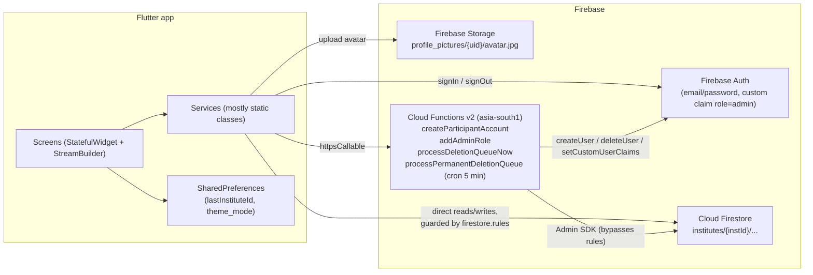
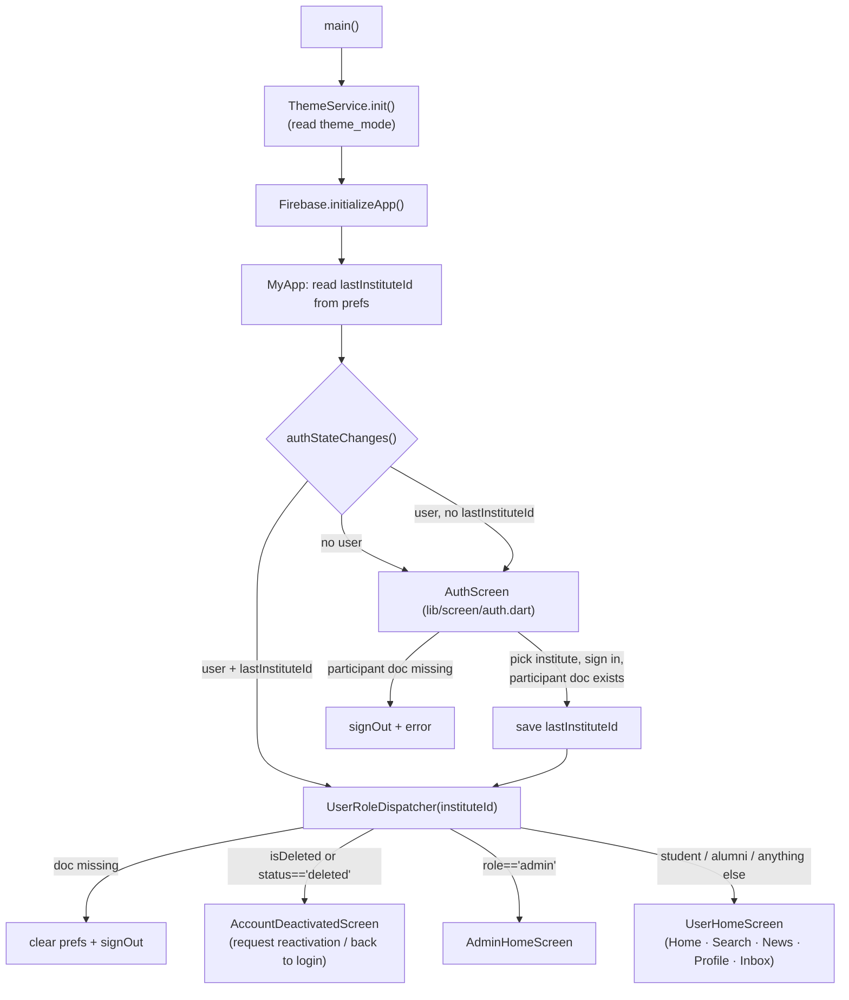
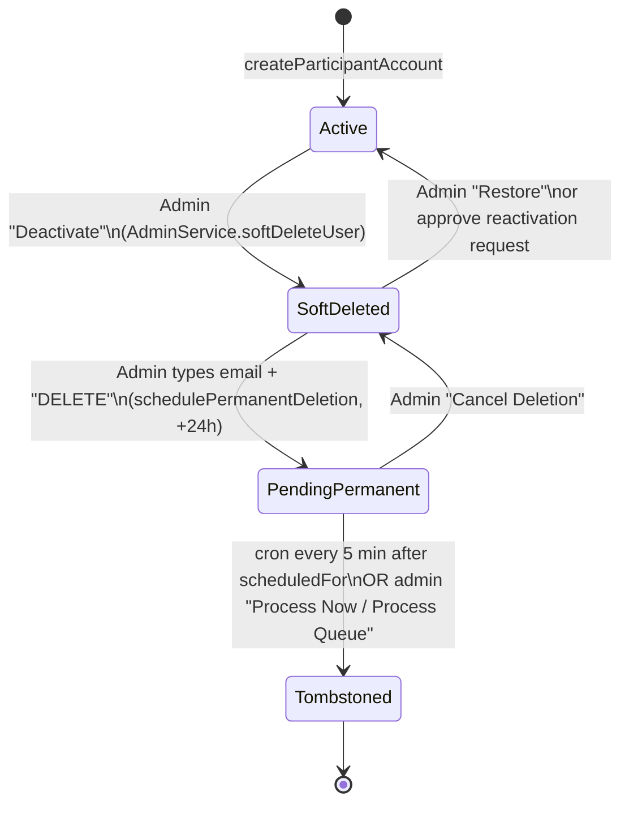

# Alma Roots (CS261-Project): Full Codebase Walkthrough & Audit

> **Scope:** every tracked source file in this repo: the Flutter app (`lib/`), Cloud Functions (`functions/`), Firestore rules/indexes, test scripts, platform config and repo-root leftovers.
> **Snapshot:** branch `main`, commit `d302089` ("Final commit"). Read on 2026-10-27.
> **Toolchain observed:** Flutter 3.35.6 (stable), Dart SDK `>=3.1.3 <4.0.0`, Node 20 for functions.
> **How to read this:** Sections 1–9 explain how the app works. Section 10 lists the problems found, ranked by severity, with file/line links. Section 11 is a prioritized fix plan.

---

## Status update (2026-10-27, branch `redesign-and-fixes`)

Most findings below have since been fixed. The original text is kept for reference; use this table for the current state.

| Finding | Status |
|---|---|
| S1 `addAdminRole` unauthenticated | **Fixed and deployed.** Caller must be an active admin of the institute |
| S2 Public sign-up | **Your action**: disable "Enable create (sign-up)" in Firebase Auth settings |
| S3 Cross-institute user creation | **Fixed and deployed.** Server-side check, plus the Add User screen is locked to your institute |
| S4 Message edit/delete by the other participant | **Fixed and deployed.** Per-field message rules (10 new tests) |
| S5–S9 Counters, visibility, post type, participant fields, Storage rules | **Fixed and deployed** (Batch 6; 42 rules tests, 6 Storage tests) |
| S10 Demo credentials in the app | Open (kept for demos) |
| S11 Personal data in logs | **Fixed.** Sensitive prints removed, the rest use `debugPrint`; `live_audit.js` deleted |
| B1 Second participant couldn't reply | **Fixed and deployed** (rules compare participants as a set) |
| B2 Process Queue wrong region | **Fixed** |
| B3 Admins couldn't reach Feed/Inbox | **Fixed.** Admin shell with Console / Feed / Inbox / Profile |
| B4 Messages reset pin/mute/archive | **Fixed** |
| B5 Tombstones shown as live users | **Fixed** (tombstones carry `isDeleted: true`; "Inactive" filter) |
| B6 Duplicate `customId` | **Fixed and deployed** (transactional per-institute counter) |
| B7 Institute management broken | **Fixed** (read-only list) |
| B8 Feed capped at 20 posts | **Fixed** ("Load older posts") |
| B9 One-way RSVP / no waitlist promotion | **Fixed and deployed.** Cancel and leave-waitlist, plus automatic promotion |
| B10 Bug reports role "unknown" | **Fixed** |
| B11 Failing rules test | **Fixed.** 27/27 passing (`npm run test:rules`) |
| B12 Scheduled deletions mislabelled in audit | **Fixed** (`AUTO_QUEUE_PROCESSING` by `system`) |
| B13 Deletion uses device clock | **Fixed and deployed** (`normalizeDeletionSchedule` sets server time + 24h) |
| B14 Partial rollback on user creation | **Fixed and deployed** (documents written in one batch) |
| B15–B19 Small UX bugs | **Fixed** (B17: the admin password is `123456`; README corrected) |
| Auto-delete job not deployed | **Fixed and deployed.** Also skips users who were restored |
| Push notifications | **Built, tested and deployed** |
| Dead code, unused packages, committed `node_modules` | **Removed**; `flutter analyze` reports no issues; widget test replaced (8 passing) |

---

## Table of Contents

1. [What the app is](#1-what-the-app-is)
2. [Repository layout (live vs. dead code)](#2-repository-layout-live-vs-dead-code)
3. [Architecture](#3-architecture)
4. [Startup, login and navigation flow](#4-startup-login-and-navigation-flow)
5. [Roles and what each one can actually do](#5-roles-and-what-each-one-can-actually-do)
6. [Feature walkthroughs](#6-feature-walkthroughs)
7. [Firestore data model](#7-firestore-data-model)
8. [Backend: Cloud Functions, security rules, indexes](#8-backend-cloud-functions-security-rules-indexes)
9. [Client internals: services, models, theme, widgets](#9-client-internals-services-models-theme-widgets)
10. [Findings (security, bugs, gaps, hygiene)](#10-findings)
11. [Prioritized fix plan](#11-prioritized-fix-plan)
12. [Build, run and test notes](#12-build-run-and-test-notes)

---

## 1. What the app is

**Alma Roots** is a multi-tenant alumni-networking app. Each *institute* is a tenant. Inside one institute there are three roles: **student**, **alumni** and **admin**. Users can:

- log in (accounts are created only by admins; there is no self sign-up in the UI),
- maintain a profile and share it by QR code,
- search the people in their institute,
- read and post to a News / Events / Experiences feed, with likes, comments and event RSVPs,
- send 1-to-1 direct messages,
- file bug reports / feedback.

Admins get a console for creating users, soft-deleting and restoring them, handling reactivation requests, scheduling permanent deletion, and triaging feedback.

**Stack:** Flutter (Material 3) client → Firebase Auth + Cloud Firestore + Firebase Storage, plus a handful of Cloud Functions (v2, Node 20, region `asia-south1`) for privileged operations. There is no custom server and no state-management library: screens are `StatefulWidget`s that call service classes and bind to Firestore via `StreamBuilder`/`listen`.

**Size:** ~11,000 lines of Dart in `lib/` across 65 files, ~364 lines of functions JS, 158 lines of security rules.

**Static analysis (`flutter analyze`, run during this review):** 103 issues, of which **0 errors**, 6 warnings, 97 infos (mostly `avoid_print`). The app compiles.

---

## 2. Repository layout (live vs. dead code)

"Live" means the code is reachable from `main.dart`. "Dead" means nothing imports or navigates to it.

```text
lib/
├── main.dart                         LIVE   App entry, theme, auth-state routing
├── firebase_options.dart             LIVE   FlutterFire config (Android + iOS only)
├── test_keywords.dart                DEAD   Scratch script with its own main(); not part of the app
├── model/
│   ├── participant_model.dart        LIVE   User/profile document
│   ├── news_event_model.dart         LIVE   Feed post
│   ├── chat_model.dart               LIVE   Chat (inbox row)
│   └── message_model.dart            LIVE   Chat message
├── service/
│   ├── user_role_dispatcher.dart     LIVE   Reads role → routes to admin/user/deactivated home (a widget, despite the folder)
│   ├── admin_service.dart            LIVE   Soft delete, restore, reactivation, deletion queue
│   ├── chat_service.dart             LIVE   Inbox/message streams, send, pin/archive, reactions, edit
│   ├── news_event_service.dart       LIVE   Posts, likes, comments, RSVP
│   ├── profile_service.dart          LIVE   Read/save participant profile + search keywords
│   ├── search_service.dart           LIVE   Prefix-keyword generation + search query
│   ├── search_migration_service.dart LIVE   Admin "Fix Search Index" backfill
│   ├── feedback_service.dart         LIVE   Bug reports
│   ├── theme_service.dart            LIVE   Light/dark/system theme, persisted
│   ├── notification_service.dart     DEAD   FCM + local notifications; never initialised
│   └── auth_service.dart             DEAD   An older, second `AuthScreen` class (with hard-coded admin map)
├── screen/
│   ├── auth.dart                     LIVE   Login screen (the real AuthScreen)
│   ├── splash_screen.dart            LIVE
│   ├── main_home_screen.dart         LIVE   "Home" tab (just a profile card)
│   ├── auth/account_deactivated_screen.dart  LIVE
│   ├── student/user_home_screen.dart LIVE   Bottom-nav shell for students & alumni
│   ├── profile/profile_screen.dart, profile_edit_screen.dart          LIVE
│   ├── search/search_screen.dart, qr_scanner_screen.dart              LIVE
│   ├── events_and_news/news_event_screen.dart, news_event_detail_screen.dart  LIVE
│   ├── message/inbox_screen.dart, chat_screen.dart, start_conversation_screen.dart  LIVE
│   ├── settings/settings_screen.dart, help_support_screen.dart, about_screen.dart, report_bug_screen.dart  LIVE
│   └── admin/
│       ├── admin_home_screen.dart                     LIVE  Admin console
│       ├── admin_add_user_screen.dart                 LIVE  Calls createParticipantAccount
│       ├── admin_participant_list_screen.dart         LIVE
│       ├── admin_permanent_delete_confirm_screen.dart LIVE
│       ├── admin_reactivation_requests_screen.dart    LIVE
│       ├── admin_deletion_queue_screen.dart           LIVE
│       ├── admin_institute_list_screen.dart           LIVE
│       ├── admin_feedback_screen.dart                 LIVE
│       ├── admin_add_alumni_screen.dart               DEAD  Creates users via Identity Toolkit REST API
│       ├── add_admin_screen.dart                      DEAD  Calls addAdminRole (wrong region, missing arg)
│       └── button.dart                                DEAD  MakeAdminButton with hard-coded email
├── theme/        app_colors, app_spacing, app_text_styles (DEAD), app_theme
├── utils/        email_validator.dart
└── widget/       app_dialog, app_empty_state, app_error_state, app_loading_view, app_snackbar (LIVE)
                  app_confirmation_dialog, user_image_picker (DEAD)

functions/index.js          Cloud Functions (4 exports)
firestore.rules             Security rules
firestore.indexes.json      Composite indexes
firebase.json               Firebase CLI config (firestore + functions; no storage section)
firestore.test.js           Mocha rules tests (emulator)
legacy_test.js              Ad-hoc rules check for legacy documents (emulator on :8080)
live_audit.js               Admin-SDK script that prints prod data for 2 hard-coded emails
package.json / node_modules Root Node deps for the rules tests (node_modules is committed; see §10.5)
test/widget_test.dart       Default Flutter counter test (fails; see §10.4)
assets/images/              logo.png (used), logo_2.png, temp.png (unused)
screenshots/                README images

Repo-root leftovers (not code the app uses):
auth_old.dart, auth_diff.txt, analyze_colors.dart, analyze_out.txt, build_log.txt, firestore-debug.log
Untracked docs: backend_architecture.md, backend_viva_interview_guide.md, dbms_concept.md,
                oops_concept.md, oops_concepts.md, rbac_concept.md
```

---

## 3. Architecture



Key design points:

- **Multi-tenancy by path.** Everything lives under `institutes/{instId}/…`. The rules derive membership and role by reading `institutes/{instId}/participants/{request.auth.uid}`.
- **Two sources of "is admin".** Firestore rules check the participant document's `role` field. `createParticipantAccount` instead checks the Auth **custom claim** `role == "admin"`. These can disagree (see §10.1).
- **Tenant selection is client-side.** The user picks an institute on the login screen; the choice is saved in `SharedPreferences` as `lastInstituteId` and passed down every screen as `instituteId`.
- **Privileged work goes through Functions.** Creating Auth users, setting claims and permanently deleting accounts need the Admin SDK. Soft delete, restore and queue scheduling are done client-side with batched writes, guarded by rules.
- **No state management.** Each screen loads its own data. Some caching is done by hand (search result cache, inbox profile cache).

---

## 4. Startup, login and navigation flow



Details:

- [lib/main.dart](lib/main.dart) loads `lastInstituteId` **once** at startup. After that, login and logout navigate by hand with `Navigator.pushReplacement`, rather than through the root `StreamBuilder`.
- [lib/screen/auth.dart](lib/screen/auth.dart) loads every institute (the `institutes` collection is world-readable), auto-selects the first one, and has "Demo Access" buttons that fill in demo credentials.
- After a successful login, if a non-admin's profile is missing `name`, `bio`, `interest`, plus `rollNo`/`year` (student) or `company`/`year` (alumni), a "Complete Your Profile" dialog appears. Both buttons only close it; neither one opens the edit screen.
- [UserHomeScreen](lib/screen/student/user_home_screen.dart) uses an `IndexedStack` with lazy first build (`_hasBeenBuilt`), so each tab is created only when first visited and then kept alive. The drawer links to Settings, Help & Support, About and Logout.
- [AdminHomeScreen](lib/screen/admin/admin_home_screen.dart) is a grid of 7 tiles: Add User, Manage Users, Reactivations, Deletion Queue, View Institutes, Feedback Reports, Fix Search Index. Its drawer has Add Participant, Settings and Logout. **It has no feed, inbox, search or profile.**

---

## 5. Roles and what each one can actually do

"Rules" = what Firestore permits. "UI" = what the app exposes.

| Capability | Student | Alumni | Admin |
|---|---|---|---|
| Log in, view own profile | ✓ | ✓ | ✓ (no profile screen in admin UI) |
| Edit own profile (not `role`/`status`/`isDeleted`/`instituteId`) | ✓ | ✓ | Rules ✓, no UI |
| Search people in institute | ✓ | ✓ | Rules ✓, no UI |
| Create post of type `experience` or `event` | ✓ | ✓ | Rules ✓, **no UI** |
| Create `news` / announcement, pin a post | ✗ | ✗ | Rules ✓, **no UI** (feed is only reachable from `UserHomeScreen`) |
| Edit/delete a post | own | own | any (rules); no UI |
| Like, comment, RSVP | ✓ | ✓ | Rules ✓, no UI |
| Direct messages | ✓ | ✓ | Rules ✓, **no inbox UI**. Students can still start a chat *to* an admin via the "Admins" filter |
| Submit feedback | ✓ | ✓ | ✓ (via Settings → Report a Bug) |
| Admin console (create/deactivate/restore users, queues, feedback) | ✗ | ✗ | ✓ |
| Create / delete institutes | ✗ | ✗ | UI shows it, but rules allow only `super_admins` |

> In short: the admin-only content features (News, Announcements, pinning) exist in code and in the rules, but no admin can reach them, because the dispatcher sends admins to a console that doesn't link to the feed.

---

## 6. Feature walkthroughs

### 6.1 Account creation (admin)

[admin_add_user_screen.dart](lib/screen/admin/admin_add_user_screen.dart) → callable `createParticipantAccount` (asia-south1) in [functions/index.js](functions/index.js):

1. Requires `auth.token.role === "admin"` (custom claim).
2. Validates email; rejects duplicates in Auth **and** across every institute (`collectionGroup("participants")`).
3. Creates the Auth user (`displayName = name || email`; the UI always sends `name: ''`, so displayName ends up being the email).
4. Generates `customId` (`s1`, `a2`, `ad3`, …) from the "highest" existing `customId`.
5. Writes `participants/{uid}` (status `active`, `isDeleted: false`, `searchKeywords`) **and** a legacy `profiles/{uid}` doc.
6. Writes an audit entry `USER_CREATED`; sets the `role: admin` claim if the new user is an admin.
7. On failure, deletes the orphaned Auth user. Firestore writes that already succeeded are not rolled back.

The admin can choose **any** institute in the dropdown, not just their own.

### 6.2 Login and deactivation

Covered in §4. A deactivated user (`isDeleted == true` or `status == 'deleted'`) lands on [AccountDeactivatedScreen](lib/screen/auth/account_deactivated_screen.dart), which can create `reactivation_requests/{uid}` (`status: pending`; using the uid as the doc ID blocks duplicates) or sign out.

### 6.3 Profile

- [ProfileScreen](lib/screen/profile/profile_screen.dart) shows your own profile, or someone else's when `viewUid` is set. A QR code of the profile's **email** is rendered only when viewing *another* person's profile.
- [ProfileEditScreen](lib/screen/profile/profile_edit_screen.dart) edits name, bio, interests/skills, year, plus roll number (student) or company (alumni). It uploads the avatar to Storage at `profile_pictures/{uid}/avatar.jpg`, sets `isProfileComplete: true`, then resets navigation to `UserHomeScreen`.
- [ProfileService.saveProfile](lib/service/profile_service.dart) merges the update with the existing document and **regenerates `searchKeywords`** from name, email, role, company, interest, year and rollNo.
- `department`, `isMentor`, `isHiring` and `openToNetworking` exist in the model and are shown in the UI (badges, intro text), but **no screen ever writes them**.

### 6.4 Search and QR

- Search uses Firestore `array-contains` on `searchKeywords`. [SearchService.generateSearchKeywords](lib/service/search_service.dart) stores every prefix of the full string **and** every prefix of each word. So "John Doe" matches `j`, `jo`, …, `john doe`, `d`, `do`, `doe`. Queries are lower-cased, debounced 500 ms, cached per query in memory, and limited to 20 results. Deleted users are filtered on the client.
- The scanner ([qr_scanner_screen.dart](lib/screen/search/qr_scanner_screen.dart), `mobile_scanner`) returns the raw string, which is put into the search box. Because the full email is one of the prefixes, scanning a QR finds that person.
- The admin "Fix Search Index" tile runs [SearchMigrationService](lib/service/search_migration_service.dart), which rebuilds keywords for every participant in 400-write batches.

### 6.5 News, events and experiences feed

- [NewsEventScreen](lib/screen/events_and_news/news_event_screen.dart) streams the 20 newest posts (pinned first), drops `status == 'deleted'` on the client, applies a **client-side** visibility filter (`public`, `alumni_only`, `students_only`, `admins_only`), and shows tabs: All / News / Event / Experience.
- The UI post types map to `(type, category)` pairs, e.g. Hackathon → `event/hackathons` and Job Opportunity → `experience/placements`. News and Announcement are offered only when the role is admin.
- Events carry `eventDate`, `eventLocation`, `maxAttendees`, `registrationRequired` and `waitlistEnabled`.
- [NewsEventService](lib/service/news_event_service.dart):
  - **Like:** a transaction toggles `posts/{id}/likes/{uid}` and increments `likeCount`.
  - **Comment:** a transaction adds `comments/{id}` and increments `commentCount`.
  - **RSVP:** a transaction respects `maxAttendees`. When the event is full it waitlists the user (if enabled) or throws "Event is full". It writes `attendees/{uid}` with status `attending` / `waitlisted` / `declined`.
  - **Delete** is soft (`status: 'deleted'`).
- The detail screen only has an "RSVP Now" button. The cancel path exists in the service but no button calls it.

### 6.6 Messaging

- Chat ID = the two uids sorted and joined with `_` ([ChatService.getDirectChatId](lib/service/chat_service.dart)), so every pair of users has exactly one chat.
- **Send:** one batch writes `chats/{id}/messages/{msgId}` and set-merges the parent chat document (`participants`, `lastMessage`, `lastMessageTimestamp`, `readStatus`, `mutedBy`/`archivedBy`/`pinnedBy`).
- **Inbox** ([inbox_screen.dart](lib/screen/message/inbox_screen.dart)) queries `participants array-contains me` ordered by `lastMessageTimestamp`, fetches the other user's profile once per uid (in-memory cache), supports search, swipe actions to pin and archive (`flutter_slidable`), an archived view, unread count and a shimmer loading state.
- **Chat screen** ([chat_screen.dart](lib/screen/message/chat_screen.dart)) checks that both profiles exist in this institute (otherwise it pops), marks the chat read, shows read ticks based on the other user's `readStatus`, supports emoji reactions, edit (own messages, enforced only in the UI), "delete for me" (`deletedBy.{uid}`), and one-tap "networking intro" templates. It blocks replies if the other user is deactivated.
- Before the first message the chat doc doesn't exist, and the rules deny reading a missing chat. The screen works around this by re-creating both streams after the first send.
- [StartConversationScreen](lib/screen/message/start_conversation_screen.dart) loads **every** participant of the institute (ordered by name) and filters by role and search text on the client.
- `ChatType.group/channel/broadcast`, attachments, `replyToMessageId`, `mutedBy` and message `searchKeywords` are modelled but not implemented.

### 6.7 User lifecycle: soft delete → permanent deletion



- **Soft delete** (client batch): sets `isDeleted: true`, `status: 'deleted'`, `deletedAt`, `deletedBy`, and writes audit `USER_SOFT_DELETED`. Admins can't delete themselves or other admins.
- **Schedule** (client batch): writes `deletion_queue/{uid}` (`pending`, `scheduledFor = now + 24h` using the **device clock**), flags the participant `pendingPermanentDeletion`, and writes an audit entry.
- **Process** (`processDeletion` in functions): deletes the Auth user; copies the participant doc to `archived_users/{uid}`; overwrites the participant doc with a tombstone `{uid, status: 'permanently_deleted', name: 'Deleted User', deletedAt, permanentDeletionAt}`; deletes `profiles/{uid}`; auto-rejects a pending reactivation request; marks the queue entry `completed`; writes an audit entry.
- Every admin action is appended to `admin_actions`. The rules make that collection create-only (no update or delete).

### 6.8 Feedback

[ReportBugScreen](lib/screen/settings/report_bug_screen.dart) collects category (Bug / UI Issue / Feature Request / Performance Issue / Security Concern / Other), title, description, steps, expected/actual result, a screenshot URL (free text) and device info (free text), then writes `feedback/{id}` with `status: open`. [AdminFeedbackScreen](lib/screen/admin/admin_feedback_screen.dart) lists reports, filters by status and category, and moves a report through `open → investigating → resolved → closed`.

### 6.9 Settings, Help, About

Only the **dark-mode** switch does anything; it is persisted by `ThemeService`. The notification and privacy switches are local `bool`s that reset every time the screen opens. Privacy Policy and Terms show "coming soon".

---

## 7. Firestore data model

All tenant data lives under `institutes/{instId}`.

| Path | Written by | Key fields |
|---|---|---|
| `institutes/{instId}` | console / super admin | `name`, `createdAt` |
| `…/participants/{uid}` | function (create), user (profile), admin (lifecycle), function (tombstone) | `uid, email, instituteId, name, role (student\|alumni\|admin), year, customId, searchKeywords[], isProfileComplete, status (active\|deleted\|permanently_deleted), isDeleted, createdAt, updatedAt, rollNo, interest, bio, company, profileImage, deletedAt, deletedBy, pendingPermanentDeletion, permanentDeletion{RequestedAt,ScheduledFor,RequestedBy}` |
| `…/profiles/{uid}` | function only | Legacy duplicate (`uid, email, name, role, isProfileComplete`). The app never reads it |
| `…/posts/{postId}` | members | `instituteId, type (news\|event\|experience), category, visibility, title, description, authorUid, authorName, authorRole, createdAt, updatedAt, isPinned, status, searchKeywords[], eventDate, eventLocation, eventStatus, registrationRequired, registrationDeadline, waitlistEnabled, attendeeCount, maxAttendees, mediaUrls[], likeCount, commentCount, imageUrl (legacy)` |
| `…/posts/{id}/likes/{uid}` | that user | `uid, name, timestamp` |
| `…/posts/{id}/comments/{id}` | author | `uid, name, text, timestamp, isDeleted` |
| `…/posts/{id}/attendees/{uid}` | that user | `uid, name, email, status (attending\|waitlisted\|declined), rsvpAt, declinedAt` |
| `…/chats/{uidA_uidB}` | participants | `type, participants[2], participantCount, lastMessage{id,text,senderId,timestamp,type}, lastMessageTimestamp, readStatus{uid:bool}, mutedBy, archivedBy, pinnedBy` |
| `…/chats/{id}/messages/{id}` | participants | `senderId, text, type, attachmentUrl, attachmentMetadata, timestamp, isEdited, isDeleted, deletedBy{uid:bool}, replyToMessageId, reactions{emoji:[uid]}, searchKeywords[]` |
| `…/admin_actions/{id}` | admins, functions | `adminUid, adminEmail, targetUid, targetEmail, action, timestamp, scheduledFor`. Actions: `USER_CREATED, USER_SOFT_DELETED, USER_RESTORED, USER_PERMANENT_DELETE_SCHEDULED, USER_PERMANENT_DELETE_CANCELLED, MANUAL_USER_DELETION, MANUAL_QUEUE_PROCESSING` |
| `…/deletion_queue/{uid}` | admins, functions | `uid, email, instituteId, scheduledFor, requestedBy, requestedAt, status (pending\|cancelled\|completed), cancelledAt/By, completedAt` |
| `…/reactivation_requests/{uid}` | user, admins | `userUid, userEmail, userName, instituteId, requestedAt, status (pending\|approved\|rejected), reviewedAt, reviewedBy, notes` |
| `…/feedback/{id}` | members, admins | `id, uid, instituteId, userRole, category, title, description, stepsToReproduce, expectedResult, actualResult, screenshotUrl, deviceInfo, status, createdAt, appVersion` |
| `…/archived_users/{uid}` | functions only | Full copy of the participant doc at permanent deletion (no rule, so clients can't read it) |
| `super_admins/{uid}` | console only | Existence grants institute write access in the rules |

Storage: `profile_pictures/{uid}/avatar.jpg`. **There are no Storage rules in this repo** (`firebase.json` has no `storage` entry), so whatever is set in the Firebase console applies.

---

## 8. Backend: Cloud Functions, security rules, indexes

### 8.1 Cloud Functions ([functions/index.js](functions/index.js))

| Export | Type / region | Auth check | Purpose |
|---|---|---|---|
| `createParticipantAccount` | callable, asia-south1 | caller has claim `role == admin` | Create Auth user + participant + profile + audit |
| `addAdminRole` | callable, asia-south1 | **none** | Set `role: admin` claim and participant `role: admin` for any email in any institute |
| `processDeletionQueueNow` | callable, asia-south1 | caller's participant doc in that institute has `role == admin` | Process one target (ignores the 24 h wait) or every due entry |
| `processPermanentDeletionQueue` | scheduled every 5 min | n/a | Processes every due `pending` entry across all institutes. The comment says "deprecated". It is still exported in the code, but `firebase functions:list` (checked 2026-10-27) shows it is **not deployed**, so overdue entries are never processed automatically |

Dependencies: `firebase-admin ^12`, `firebase-functions ^5`. `algoliasearch` is listed but never used.

### 8.2 Security rules ([firestore.rules](firestore.rules)), summarised

Helpers: `isInstituteMember` (participant doc exists), `isActiveMember` (member and `status` is `active`, defaulting to active when missing), `isAdmin` (member and `role == 'admin'`; does **not** require active).

| Collection | Read | Write |
|---|---|---|
| `institutes/{id}` | anyone, even signed-out | `super_admins` only |
| `participants/{uid}` | self, any active member, admin | create/delete: admin. Update: admin, or self while active and without changing `role/status/isDeleted/instituteId` |
| `posts` | active member or admin | create: author = self and (admin, or student/alumni with type `experience`/`event`). Update: admin, the author, or *anyone* touching only `likeCount/commentCount/attendeeCount`. Delete: admin or author |
| `posts/*/comments` | active member/admin | create own; update/delete own or admin |
| `posts/*/likes/{uid}`, `attendees/{uid}` | active member/admin | write own doc only |
| `chats/{id}` | active participant | create: exactly 2 participants including self. Update: participant, `participants` unchanged |
| `chats/*/messages` | active participant | **read and write**: any participant, any message |
| `admin_actions` | admin | create only, with `adminUid == self`. Immutable |
| `deletion_queue` | admin | admin |
| `reactivation_requests/{uid}` | self or admin | create self (pending); update admin, or self keeping pending; delete admin |
| `feedback` | admin | create: active member; update/delete: admin |

### 8.3 Indexes ([firestore.indexes.json](firestore.indexes.json))

Composite indexes for: chats (`participants` CONTAINS + `lastMessageTimestamp` desc), reactivation_requests (`status` + `requestedAt` desc), deletion_queue (`status` + `scheduledFor`, collection **and** collection-group, the latter for the cron job), and posts (`isPinned`+`createdAt`, `type`+`createdAt`, `category`+`createdAt`, `visibility`+`createdAt`), plus a field override for `posts.searchKeywords`. Only the `isPinned`+`createdAt` posts index is used by current code.

---

## 9. Client internals: services, models, theme, widgets

**Services.** Most are classes with `static` methods and a static `FirebaseFirestore.instance` (`AdminService`, `ChatService`, `SearchService`, `FeedbackService`, `SearchMigrationService`). `ProfileService(instituteId)` and `NewsEventService()` are created per screen. They aren't singletons, whatever the README says. None of them can be injected, so none can be unit-tested without a live Firebase.

**Models.** Each has a `fromFirestore` factory with legacy fallbacks (e.g. `picture → profileImage`, `skills → interest`, `createdBy → authorUid`, `likes[] → likeCount`) and a `toMap`/`toJson`. `ParticipantModel.toJson` always stamps `updatedAt: serverTimestamp()`.

**Theme.** [app_theme.dart](lib/theme/app_theme.dart) defines Material 3 light and dark themes seeded from `AppColors.primary` (#1565C0), using the Inter font via `google_fonts`. `AppSpacing` provides a 4/8/16/24/32/48 scale and gap widgets. `AppTextStyles` is unused. Several screens (notably the login screen) still hard-code colours instead of using the theme.

**Shared widgets.** `AppSnackBar` (success/error/info), `AppLoadingView`, `AppEmptyState` and `AppErrorState` (animated), `AppDialog`. `AppConfirmationDialog` and `UserImagePicker` are unused.

**Packages.**

| Package | Status |
|---|---|
| cloud_firestore, firebase_core, firebase_auth, firebase_storage, cloud_functions, image_picker, qr_flutter, mobile_scanner, shared_preferences, intl, shimmer, flutter_slidable, cached_network_image, google_fonts | used |
| http | used only by the dead `AdminAddAlumniScreen` |
| firebase_messaging, flutter_local_notifications | used only by the dead `NotificationService` |
| liquid_swipe, rxdart | **unused** |
| intl_utils | a code generator; belongs in `dev_dependencies` and is unused anyway |
| cupertino_icons | default |

---

## 10. Findings

Severity: **Critical**: lets an attacker take over the system. **High**: a core feature is broken, or a real security weakness. **Medium**: wrong behaviour or a data-integrity problem. **Low**: polish, dead code, hygiene.
Confidence is stated where a finding was not confirmed at runtime.

### 10.1 Security

| # | Sev | Finding | Where | Fix |
|---|---|---|---|---|
| S1 | **Critical** | `addAdminRole` has **no authentication or authorization check**. Any caller, even a signed-out one, can make any email an admin of any institute (sets the custom claim **and** `participants/{uid}.role = 'admin'`). | [functions/index.js:164-197](functions/index.js#L164-L197) | Require `request.auth` and verify the caller is an admin *of that `instituteId`* (or a super admin). Better still, delete this function: `createParticipantAccount` already handles admins. |
| S2 | **Critical** (chained) | Self-registration is possible outside the app: `AdminAddAlumniScreen` shows that the Identity Toolkit `accounts:signUp` REST endpoint works with the public API key, so email/password sign-up is enabled for the project. Combined with S1, anyone can create an account, promote themselves, and get full admin rights in any institute (including `createParticipantAccount`, which trusts the claim). | [admin_add_alumni_screen.dart:79](lib/screen/admin/admin_add_alumni_screen.dart#L79) | Fix S1. Turn off public sign-up in Firebase Auth settings (users are created via the Admin SDK anyway). Delete the dead screen. |
| S3 | High | `createParticipantAccount` checks only a **global** admin claim, never that the caller administers the `instituteId` they pass. The UI's institute dropdown lists every institute, so an admin of A can create users, including admins, in B. | [functions/index.js:15](functions/index.js#L15), [admin_add_user_screen.dart:161-178](lib/screen/admin/admin_add_user_screen.dart#L161-L178) | Look up the caller's participant doc in `instituteId` and require `role == 'admin'`. Store `instituteId` in the claim. Lock the dropdown to the admin's own institute. |
| S4 | High | Any chat participant can edit or delete **the other person's** messages and rewrite their reactions or `deletedBy`; the rule is a blanket `read, write`. The "edit only my messages" check exists only in the UI. | [firestore.rules:122-125](firestore.rules#L122-L125) | Split into `create` (`senderId == auth.uid`), `update` (sender may change `text/isEdited`; anyone may change only their own `reactions`/`deletedBy` keys), and `delete: false`. |
| S5 | Medium | Engagement counters can be set to **any value** by any active member: the rule checks *which* keys change but not by how much. | [firestore.rules:77](firestore.rules#L77) | Require `request.resource.data.likeCount == resource.data.likeCount ± 1` (same for the others), or move counters to a Function trigger. |
| S6 | Medium | Post `visibility` (`alumni_only`, `admins_only`, …) is enforced **only on the client**; the rules let every active member read every post. | [news_event_screen.dart:92-96](lib/screen/events_and_news/news_event_screen.dart#L92-L96) | Enforce it in the `posts` read rule and query with a matching `where('visibility', whereIn: …)`. |
| S7 | Medium | A post author can change `type` on update (e.g. a student turns their `experience` into `news`), because update rules don't re-check `type`/`isPinned`. | [firestore.rules:70-79](firestore.rules#L70-L79) | For non-admins, require `type` and `isPinned` to be unchanged. |
| S8 | Medium | Every active member can read **every participant document in full**: emails, deletion metadata, `pendingPermanentDeletion`, and so on. Users can also self-edit fields such as `email`, `customId` and `pendingPermanentDeletion`. | [firestore.rules:44-53](firestore.rules#L44-L53) | Whitelist self-editable keys with `affectedKeys().hasOnly([...])`. Consider a public-profile subset. |
| S9 | Low | No Storage rules in the repo. Whether a user can overwrite someone else's `profile_pictures/{uid}` depends on console settings nobody can see here. | [firebase.json](firebase.json) | Add `storage.rules` (write only when `request.auth.uid == uid`, images only, size cap) and register it in `firebase.json`. |
| S10 | Low | Demo credentials (README, and login buttons with the admin password) ship in the production build. | [auth.dart:466-494](lib/screen/auth.dart#L466-L494), [README.md](README.md) | Hide them behind `kDebugMode`. Rotate the passwords before any real use. |
| S11 | Low | `live_audit.js` prints production participant data for two real-looking emails (`lokesh@email.com`, …), and verbose `print`s log emails and full Firestore docs on login. | [live_audit.js](live_audit.js), [auth.dart:107-134](lib/screen/auth.dart#L107-L134) | Delete the script. Replace `print` with `debugPrint` behind `kDebugMode`. |

> `firebase_options.dart` and `google-services.json` contain API keys. That is normal for Firebase client apps (the keys identify the project and are not secrets). Security has to come from rules and Auth settings, which is why S1–S2 matter.

### 10.2 Functional bugs

| # | Sev | Finding | Where | Fix |
|---|---|---|---|---|
| B1 | **High** (high confidence; confirm in the emulator) | **The second person in a chat can't reply.** `sendDirectMessage` writes `participants: [currentUserId, otherUserId]`, in sender-first order. The update rule requires `participants` to be *equal* to the stored array, and list equality in rules is order-sensitive. When B replies to a chat A started, the merge writes `[B, A]` ≠ `[A, B]`, the update is denied, and the whole batch fails ("Failed to send message"). | [chat_service.dart:105](lib/service/chat_service.dart#L105), [firestore.rules:118-120](firestore.rules#L118-L120) | Write the sorted pair, and only on create: `final ids = [a, b]..sort();`. Or leave `participants` out of the merge on existing chats. Add a rules test for "B replies". |
| B2 | **High** | **"Process Queue" / "Process Now" call the wrong region.** The client uses `FirebaseFunctions.instance` (us-central1), but the function is deployed to `asia-south1`, so the call fails with NOT_FOUND. The 5-minute cron is not deployed either, so before this fix, deletions never ran at all. **(Fixed.)** | [admin_service.dart:339](lib/service/admin_service.dart#L339) | `FirebaseFunctions.instanceFor(region: 'asia-south1')`. |
| B3 | **High** | **Admins can't reach the feed or inbox**, so News/Announcement posting and pinning, which are admin-only, can't be used at all. Students can message an admin, but the admin can never see it. | [user_role_dispatcher.dart](lib/service/user_role_dispatcher.dart), [admin_home_screen.dart:113-137](lib/screen/admin/admin_home_screen.dart#L113-L137) | Add "News & Events" and "Inbox" tiles to the admin console (both screens already accept `instituteId`). |
| B4 | Medium | **Every new message resets pin, mute and archive for both users**: the merge sets `pinnedBy`/`mutedBy`/`archivedBy` to `{me: false, other: false}`. | [chat_service.dart:120-122](lib/service/chat_service.dart#L120-L122) | Set these maps only when the chat is created (check existence in a transaction), or don't write them at all. `ChatModel` already treats missing keys as `false`. |
| B5 | Medium | **Tombstoned users show up as live users.** Permanent deletion writes `status: 'permanently_deleted'` without `isDeleted`, but the filters only check `isDeleted`/`status == 'deleted'`. "Deleted User" therefore appears in Manage Users (with a Deactivate button, defaulting to role student) and in Start Conversation. | [admin_participant_list_screen.dart:140](lib/screen/admin/admin_participant_list_screen.dart#L140), [start_conversation_screen.dart:60](lib/screen/message/start_conversation_screen.dart#L60), [functions/index.js:228-234](functions/index.js#L228-L234) | Add `isDeleted: true` to the tombstone and/or filter `status != 'active'`. Centralise the check in a helper such as `ParticipantModel.isActive`. |
| B6 | Medium | **Duplicate `customId`s.** `orderBy("customId", "desc")` sorts strings, so `s9` > `s10`, and once you pass 9 the "next" ID gets reused. All roles share one counter regardless of prefix, and concurrent creates race. | [functions/index.js:60-68](functions/index.js#L60-L68) | Use a counter document incremented in a transaction (one per institute/role), or drop `customId`. |
| B7 | Medium | **Institute management is broken for normal admins.** Add/Delete call client writes that the rules allow only for `super_admins`. Delete would also orphan every subcollection, and the list's `orderBy('createdAt')` hides institutes that lack that field. | [admin_institute_list_screen.dart:32,60,165](lib/screen/admin/admin_institute_list_screen.dart#L32) | Hide the tile unless the user is a super admin, or move this to a Function. Never delete an institute from the client. |
| B8 | Medium | **Feed shows at most 20 posts, ever.** The code says "limit(20) for pagination", but there is no "load more". Soft-deleted posts still use up slots, because the filter runs after the limit. | [news_event_service.dart:15-25](lib/service/news_event_service.dart#L15-L25) | Add `where('status', isEqualTo: 'published')` (needs an index) plus cursor pagination with `startAfterDocument`. |
| B9 | Medium | **RSVP is one-way.** There is no cancel button. The UI doesn't show whether you've already RSVPed (pressing again says "RSVP Confirmed!" and does nothing). Waitlisted users are never promoted. | [news_event_detail_screen.dart:202-213,384-395](lib/screen/events_and_news/news_event_detail_screen.dart#L202-L213) | Stream `attendees/{me}` to drive an RSVP/Cancel toggle, and promote the oldest waitlisted attendee on cancel. |
| B10 | Medium | **Bug reports always record `userRole: 'unknown'`.** The code reads a top-level `users/{uid}` collection that doesn't exist (and has no rule), and silently swallows the error. | [report_bug_screen.dart:59-66](lib/screen/settings/report_bug_screen.dart#L59-L66) | Read `institutes/{instId}/participants/{uid}`. |
| B11 | Medium | **The rules test suite fails as written.** "Alumni Cannot create event" expects denial, but the rules explicitly allow students/alumni to create `event` posts. The test also never covers B1, S1 or S4. | [firestore.test.js:107-113](firestore.test.js#L107-L113), [firestore.rules:67](firestore.rules#L67) | Decide the intended policy and align the test or the rule. Add tests for chat replies and message edits. |
| B12 | Low | The scheduled job logs automated deletions as `MANUAL_QUEUE_PROCESSING`, attributed to the admin who *scheduled* the deletion. | [functions/index.js:257-263](functions/index.js#L257-L263) | Pass a mode flag and log `AUTO_QUEUE_PROCESSING` with `adminUid: 'system'`. |
| B13 | Low | Deletion is scheduled with the **device clock** (`DateTime.now() + 24h`), so a wrong phone clock shifts the deletion time. | [admin_service.dart:238-240](lib/service/admin_service.dart#L238-L240) | Store `requestedAt: serverTimestamp()` and compute "due" on the server, or set `scheduledFor` in a Function. |
| B14 | Low | `createParticipantAccount` rollback deletes the Auth user but leaves any participant/profile/audit docs already written. | [functions/index.js:131-140](functions/index.js#L131-L140) | Write the three docs in one batch after the Auth user exists, and delete them in the rollback. |
| B15 | Low | The "Complete Your Profile" dialog's "Got it" button does nothing; it should open the edit screen. | [auth.dart:166-184](lib/screen/auth.dart#L166-L184) | Navigate to `ProfileEditScreen` on "Got it". |
| B16 | Low | Your own QR code is never shown. The QR appears only when viewing *someone else's* profile (the condition looks inverted). | [profile_screen.dart:397](lib/screen/profile/profile_screen.dart#L397) | Show it when `viewUid == null` or equals the current uid. |
| B17 | Low | Demo "Admin" button fills password `123456`, but the README says `Demo@123`. One of them is wrong. | [auth.dart:489](lib/screen/auth.dart#L489) | Make them match. |
| B18 | Low | Profile fields `department`, `isMentor`, `isHiring` and `openToNetworking` are read and displayed but never writable, so the Mentor/Hiring badges never appear and intros always say "Department: N/A". | [chat_service.dart:235](lib/service/chat_service.dart#L235) | Add the fields to `ProfileEditScreen`, or remove them. |
| B19 | Low | Likes, comments and RSVPs store `user.displayName`, which is the user's **email** (set at creation), not their profile name. | [news_event_detail_screen.dart:45-90](lib/screen/events_and_news/news_event_detail_screen.dart#L45-L90) | Pass the participant's `name`. |

### 10.3 Incomplete / stub features

- **Notifications:** the bell icon is a no-op, the settings switches aren't persisted, `NotificationService` is never initialised, no FCM tokens are stored, and no Function sends pushes. The README lists push notifications as a *future* enhancement, which matches.
- **Privacy settings** (Profile Visibility, Show Email, Show Contact): UI only.
- **Home tab** ([main_home_screen.dart](lib/screen/main_home_screen.dart)): only a profile card using the Auth `displayName` (the email). No activity, suggestions or stats.
- **Group chats, channels, broadcast, attachments, replies, mute, message search:** modelled in `ChatModel`/`MessageModel`, not implemented.
- **Comment deletion:** allowed by the rules, but there is no UI, and `commentCount` is never decremented.
- **Web/desktop:** `firebase_options.dart` throws on every platform except Android/iOS.

### 10.4 Code quality

- **Dead code to delete:** `lib/service/auth_service.dart` (a second `AuthScreen` with a hard-coded `adminInstituteMap`), `lib/test_keywords.dart`, `admin_add_alumni_screen.dart`, `add_admin_screen.dart` (also broken: default region, no `instituteId`), `button.dart` (hard-coded `admin@example.com`), `notification_service.dart` (unless you wire it up), `app_confirmation_dialog.dart`, `user_image_picker.dart`, `app_text_styles.dart`, and the `profiles` collection writes.
- **Unused dependencies:** `liquid_swipe`, `rxdart`, `intl_utils`, and `http` once the dead screen is gone. In functions: `algoliasearch`.
- **`UserRoleDispatcher` is a widget living in `service/`.** Move it to `screen/`.
- **No dependency injection.** Static services that grab `FirebaseFirestore.instance` make unit tests impossible without the emulator.
- **Duplicated logic:** keyword generation exists in four places (`SearchService`, `ProfileService`, `SearchMigrationService`, and the Functions' own different tokeniser). The functions version produces different keywords (no prefixes) from the client, so new users are only partially searchable until someone edits their profile or an admin runs "Fix Search Index". The "is this user deleted?" check is also copied across five or more files.
- **Logging:** 80+ `print` calls, some dumping user data (`avoid_print` accounts for most of the 97 analyzer infos).
- **Unsafe `setState`:** a few spots call it after `await` without a `mounted` check (e.g. `_loadInstitutes` in [auth.dart:65](lib/screen/auth.dart#L65), [admin_add_user_screen.dart:123](lib/screen/admin/admin_add_user_screen.dart#L123)).
- **Over-fetching:** `StartConversationScreen` and `AdminParticipantListScreen` load every participant in the institute. That's fine for a demo, but reads grow with institute size.
- **Tests:** [test/widget_test.dart](test/widget_test.dart) is the untouched Flutter counter template and **fails** (it pumps an empty `MaterialApp` and expects a "0"). There are no unit tests for services or models.

### 10.5 Repository hygiene

- **Root `node_modules/` is committed: 14,924 files.** `.gitignore` doesn't exclude it. Add `node_modules/` and remove it with `git rm -r --cached node_modules`.
- Scratch files committed at the root: `auth_old.dart`, `auth_diff.txt`, `analyze_colors.dart`, `analyze_out.txt` (stale: it lists imports that no longer exist), `build_log.txt` (UTF-16, a failed `flutter run` with Kotlin version warnings). `firestore-debug.log` is present locally.
- Root `package.json` has no `test` script. Running `firestore.test.js` needs `firebase emulators:exec "npx mocha firestore.test.js"`.
- Unused assets: `assets/images/logo_2.png` and `temp.png` are bundled (the whole `assets/images/` folder is declared) but never referenced.
- `pubspec.yaml` description is still "A new Flutter project." The Android `applicationId` and iOS bundle ID are still `com.example.*`, which Play Store/App Store won't accept.
- The six untracked Markdown study guides (`*_concept(s).md`, `backend_*.md`) overlap each other (`oops_concept.md` vs `oops_concepts.md`).

---

## 11. Prioritized fix plan

**Do first (security, about an hour):**
1. Lock down or delete `addAdminRole` (S1), and disable public email/password sign-up in the Firebase console (S2). Redeploy functions.
2. Make `createParticipantAccount` verify the caller administers the target institute (S3).
3. Tighten the `messages` and post-counter rules (S4, S5). Add rules tests for each.

**Then (make the core flows work):**
4. Chat `participants` ordering (B1) and the pin/mute/archive reset (B4). These are both small changes in `ChatService.sendDirectMessage`.
5. Region for `processDeletionQueueNow` (B2).
6. Add News & Events and Inbox to the admin console (B3).
7. Treat `permanently_deleted` as inactive everywhere (B5).
8. Fix or remove the failing tests (B11, widget test).

**Then (correctness and polish):**
9. `customId` counter (B6), institute management (B7), feed pagination and status filter (B8), RSVP toggle (B9), feedback role (B10).
10. Server-side visibility enforcement (S6), post-type immutability (S7), field whitelist for self-updates (S8), `storage.rules` (S9).

**Housekeeping:**
11. Delete the dead files and unused packages (§10.4). Untrack `node_modules` and the scratch files (§10.5). Replace `print` with `debugPrint`. Set real app IDs.

---

## 12. Build, run and test notes

```bash
# App
flutter pub get
flutter run                       # Android / iOS only (no web/desktop Firebase config)
flutter analyze                   # currently: 103 issues, 0 errors

# Backend
cd functions && npm install
firebase deploy --only functions
firebase deploy --only firestore:rules,firestore:indexes

# Rules tests (needs Java + firebase-tools)
npm install                       # root package.json → @firebase/rules-unit-testing, mocha
firebase emulators:exec --only firestore "npx mocha firestore.test.js"
```

Config files that must exist locally: `android/app/google-services.json` (committed), `lib/firebase_options.dart` (committed), and the iOS `GoogleService-Info.plist` (not in the repo; iOS builds need it).
